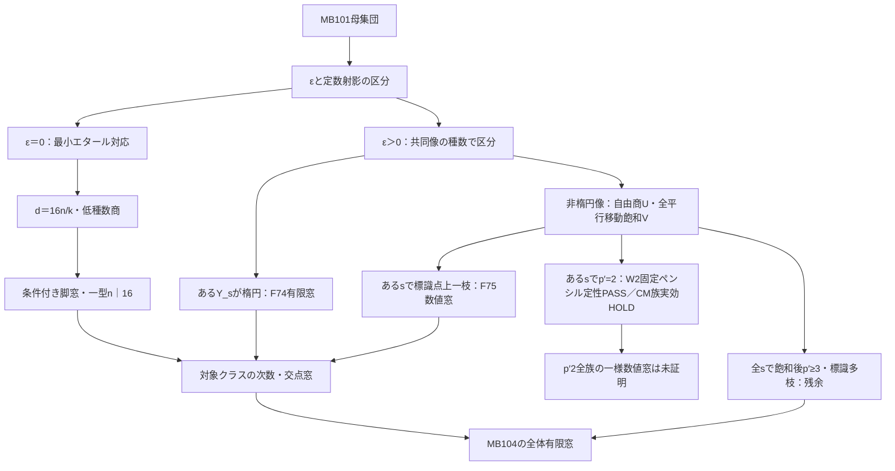

# MB104 研究統合記録 v0.25 — F82追補Dの条件付き監査・A/B保留判断を既存A〜Eへ差分統合

更新：2026-11-01 JST／F82追補D1〜D3の条件付き独立監査を既存D2へ差分統合。A/B外部独立評価のPARKED（数学OPEN・評価内容は未監査）を管理判断として反映。C/E現行OPENを維持。既存v0.24の統合本文は履歴として保全。数学研究・新ルート・実候補排除・公式creditの追加なし。
CURRENT_INTEGRATION_REGION_START
AS_OF: 2026-11-01 JST／MB104研究統合記録v0.25。旧v0.24のF82-A/B・追補C・F81限定監査判定を全て保持した上で、F82-Dの限定監査結果とA/B研究優先度の外部評価を差分として統合する。Fは第6数学ルートではなくOWNER=D。新しい実候補の排除0、公式credit0。数学研究なし。

CURRENT_DRIVE_SYNC_HANDOFF: https://docs.google.com/document/d/1hW2_txCNabPXzTtuS4vDq66nCaxb1tNaDZj1NtZNiEg/edit
CURRENT_A_TO_E_INDEX: https://docs.google.com/document/d/10QAZSl5Qjic_gnsGzpRtNaD1TmG7JNZlau7gzQTu3vs/edit
SOURCE_F82: https://docs.google.com/document/d/12rgaQgnCufwVYfKWQ9rOW2qL7XkhrEDzV07rdVuPZL0/edit
AUDIT_F82: https://docs.google.com/document/d/1nLFKfmCoAjzZps0D5w3_t7Ngp8FyfMKTLAuUG9X2N2c/edit （冒頭ACTIVE_F82_APPENDIX_D_INDEPENDENT_AUDIT_REGION／C/A-Bの旧独立監査も同一文書の別領域）
SOURCE_F75: https://drive.google.com/file/d/1MtWGizZfbF3A0mBh_JW9gOizeHtK0nLM/view
SOURCE_F76: https://drive.google.com/file/d/1xPmee8Th8ecWfFvpruy25RitRrxlINjd/view
SOURCE_F72: https://drive.google.com/file/d/11Dk9MqvBwUfkNPRDCOgEjm0361snGl0k/view
SOURCE_F81: https://drive.google.com/file/d/1dzoOvrkt-SoEmY_fDB46hFh9-62PY_Vt/view

A_EXISTING_ROUTE: PARKED／数学OPEN。r=1..4、864支持、Stein/common-vertical補正と全候補一様有限次数・交点窓の証明はOPEN。000707の種数7ファイブレーション最小P・F=36は対象限定既存成果。2026-11-01のClaude外部評価に由来するκ補題（κ<304ならr3有限化という条件付き提案、r4でκ=384必要など）はPROVISIONAL／元証明の独立監査・κ具体値未了（HOLD）、r1,2には効かない。これは正式なNO-GO確定でも、A全体の数学的不能の証明でもない。CURRENT_A_REVIEW_20261101を索引で確認。実候補排除0・credit0。
B_EXISTING_ROUTE: PARKED／数学OPEN。衝突δ会計・分岐半因子・抽象指標線・自由切断jetなど方法限定NO-GOは維持。実source正規化、marked conductorにおける反不変一次係数・符号付きgluing、種数1感応の独立制約が未完。F45とF46は同じglobal norm/Picゲートの等価表現で二重計上しない。F49のtorsor分裂は各引戻し成分のCartier性・実marked gluingの自動証明ではない。F63の固定複素モデル整曲線・Q=0・norm分裂は条件付き監査範囲であり、種数1／実source不存在の証明ではない。Claudeの『導手符号データは曲線そのもので外部から原理的に取得不能』は未証明の絶対主張として認定しない。CURRENT_B_REVIEW_20261101を索引で確認。実候補排除0・credit0。
C_EXISTING_ROUTE: OPEN（今回のClaude追加評価なし）。C16のw大域零点強制、C17Rの多方向特殊配置・真の種数1／有効性・変形の障壁は不変。C14/C18A、F61〜68固定モデル内の限定監査を実担体除外に自動拡張しない。旧C14残5列、Severi期待次元、一般元の高種数計算をNEXTとして再計上しない。新排除0・credit0。
D_EXISTING_ROUTE: 既存D1／F81は固定CMペンシル・L等の明示条件付きPASSを保持し、可変CM族E1/M0実効一様上限・滑らかな最大torsion成分はHOLD。既存D2／F82-A/BとC1〜C5はF72/F75〜79の実正規化・源標識条件下で独立監査CONDITIONAL_PASS（再証明・重複認定なし）。F82-C: k4ならb≤2a、k8ならb≤3a、B_s≤(8+2k)a等は必要条件であってa,bの絶対上限ではない。
D2_NEW_AUDITED_DELTA_F82_D: F82追補D1・D2は独立監査で、同じK=ℂ(Y)／同じsとS／同じC8→E_s二重被覆／同じ指標χ_{αu}=χ_uを仮定したときCONDITIONAL_PASS。D1: 分岐対称差からdegα≤1+(k/4)(1+(r0−1)/a)≤1+k/4。D2: F76のCM模型End(E_s)=ℤ[i]、4捩れ標識、対合固定点を利用し非単元の次数2も排除、したがって原点保存自己準同型αにdegα=1が必要。D3: [n] (|n|≥2) の同一標識保持不能はD1の系としてCONDITIONAL_PASS、独立新規定理と二重計上しない。監査に伴うSCOPE_CORRECTION: h_cov=2では二脚のχ1=χ2が成立するが、h_cov=4のV4被覆では一般に独立な2指標があるのでχ1=χ2を無条件に要求しない。D2.2は単一uへの自己同種後合成の排除に限定し、異なるY・異なるu1/u2の直接比較に適用しない。研究原本のPROVISIONALは提出時表示で、監査正本でのD1/D2/D3の現行評価は限定PASS、元source chain全体の無条件再監査ではない。
D2_REMAINING_HOLD: 全sのp′≥3飽和後・標識多枝・二脚balanced次数同時増大を覆う一様B_s≤λ(a1+a2)+c（λ<h_cov）またはdeg(h1)+deg(h2)の一様絶対上限、δ=1/2実source passportとの整合、β′固定16点外の枝、実候補排除はOPEN/HOLD。旧W有限単純除外と旧全p′2 d_box≤2^62+32の提示証明FAILは改善されていない。新排除0・credit0。
E_EXISTING_ROUTE: CORELESS + NO NONEMPTY CLUMP／実source正規化上6超平面の全付値・補助Wの実分岐・marked conductor等OPEN/PARKED。rational-core閉鎖の旧GitHub前監査主張を全32-03消去と混同しない。F70/71の対象限定数値窓を全MB104に外挿しない。F82-DはEの実補助被覆Wの分岐や6付値を自動解決しない。新排除0・credit0。

NEXT_A: PARKEDを維持。κ補題を活用するなら成立条件・交点計算・Λ列挙・κの値を独立監査した上で、さらにr1,2を閉じる別の証明が必要。旧殻/P・F=40計画、浅いr4、同じ判別式計算は再開しない。
NEXT_B: PARKEDを維持。実sourceでの反不変一次jet／正規化枝対応と導手符号gluingに、新たな種数1感応の強制条件または独立不等式を与え、実候補排除／有限窓までの接続を示す。『未知データ待ち』だけでは再開条件として不十分。
NEXT_C: C16のw零点強制またはC17R特殊配置／種数1有効性への独立制約。前回の条件付き固定モデルPASSを全母集団へ無条件移送しない。
NEXT_D1: 可変CM同種全族のE1/M0／滑らか1D maximal torsion cosetを支配する正当な共通実効上限（正しい定義体・偏極・指数条件でManin–Mumfordを適用）。
NEXT_D2: F75のh_cov=2では同じ二次指標の異なる写像u1,u2間の剛性を、h_cov=4ではそれぞれの独立ラベル保存を厳密に区別したうえで、実C8二脚passport、δ=1/2、marked多枝から一様B_sまたはdeg(h1)+deg(h2)上界/不存在へ導く。追補Dの自己同種後合成排除を別u間の絶対次数制限と誤認しない。
NEXT_E: CORELESS／NO NONEMPTY CLUMP残余に実source上6超平面の全消失次数・偶奇または補助Wの実分岐を強制する新しい独立証明。旧Abel/norm単独の再演は失効。
SUPERSEDED_NEXT: F82-D独立監査待ちは解消（明示条件下の限定PASS）。F82-Dを絶対次数上限や別u間の一致に昇格する旧期待は不許可。F82-A/B/CやF75/F76の重複登録、r1..4決着済み扱い、A/B保留を数学的全NO-GOとして確定、F63高種数一般例を種数1排除へ拡張することも禁止。従前のSUPERSEDEDはv0.24以下の履歴を継承。

GITHUB_HOOK: 2026-10-26観測のmain SHA b647f33e1c36c6f156d2a81a1e6f146ae2c7b550。MB104 PR #1827はマージ済みだが、GitHub STATEはFROZEN_AUDIT_REPAIR_READY_NO_CREDITであり、最終HOSTILE AUDIT PASSの範囲はcurrent-main整合／根拠提示・監査修復であって数学成果の昇格ではない。STATEの正式な凍結解除遷移とローカル検証が別途必要。Google Driveの記録更新＝GitHubへの書込み許可ではない。MB-FIBは別COLD・重計算無許可。
GLOBAL: 32-03／MB104有限次数・交点窓OPEN。実担体新規評価／排除0。公式receiver/effectivity/theorem/endpoint/Perfect-Cuboid credit0。新ルート作成・GitHub STATE更新・重計算・マージなし。既存v0.24の統合領域は次のHISTORICAL_V024...に完全保全し、数学的新成果と旧式の再計上を行わない。
CURRENT_INTEGRATION_REGION_END

## 履歴統合 v0.24（F82追補Cまで、本文保存）
HISTORICAL_INTEGRATION_V024_REGION_START
AS_OF: 2026-11-01 JST／MB104研究統合記録v0.24。最新差分F82追補C（C1〜C5）の条件付き独立監査PASSを既存D2へ統合。前回のA1/A2・B1〜B5条件付きPASS、D1/F81の限定監査状態を保持する。Fは第6数学ルートでなく、数学研究・実候補排除・公式creditの追加なし。
SOURCE_F82: https://docs.google.com/document/d/12rgaQgnCufwVYfKWQ9rOW2qL7XkhrEDzV07rdVuPZL0/edit （原著末尾【F82研究追補C】、提出時PROVISIONAL）。
AUDIT_F82: https://docs.google.com/document/d/1nLFKfmCoAjzZps0D5w3_t7Ngp8FyfMKTLAuUG9X2N2c/edit （現行ACTIVE_F82_APPENDIX_C_INDEPENDENT_AUDIT_REGION、直後のACTIVE_F82_INDEPENDENT_AUDIT_REGIONでA/Bの既監査判定を保持）。
SOURCE_F75: https://drive.google.com/file/d/1MtWGizZfbF3A0mBh_JW9gOizeHtK0nLM/view （F82-Cの全式に必要な元RH・標識・次数恒等式）。
SOURCE_F81: https://drive.google.com/file/d/1dzoOvrkt-SoEmY_fDB46hFh9-62PY_Vt/view ／同じ監査記録のF81現行限定判定。
INDEX: https://docs.google.com/document/d/10QAZSl5Qjic_gnsGzpRtNaD1TmG7JNZlau7gzQTu3vs/edit （既存研究台帳／研究ルート索引v0.29）。
ROUTE_MAPPING: F82-A/B/Cは既存D（C8エタール対応・導手対の押し下げ／D2=飽和p′≥3・標識多枝）へEXTEND。追補CはF75の正ε実共同像j:Y→E_s²全成立範囲の必要条件であり、特別なp′≥3の残余にのみ有効と狭めない。A=次数/交点・Stein参照、B=実反不変導手・標識枝参照、C=w零点/特殊配置参照、E=coreless/no-clump/6付値参照。A/B/C/Eに新数学成果を重複登録しない。
F82_A_B_PREVIOUS: A1/A2/B1〜B5はF75〜79の実正規化、有限エタール飽和φ:A→A1とp:Y→V（同じ次数N=m|K|≤16）、j1像への双有理性・Stab_trans=0、β′=[-1]+c、r′≤1、p′≥3などを前提とするCONDITIONAL_PASS。A1標識枝超過の点別輸送、A2 Kummer16例外曲線奇数接触RH、B1逆同種とdeg h_i=N a_i、B2二平方類一致（r′=1はPic⁰[2]障壁）、B3共通合成次数δ∈{1,2}、B4 δ2では分岐奇偶対称差≤4点、B5 B_s≤4N#H⁻¹(T×T)、|T|=10、100は値数のみ。全s一様B_*や次数上限は含意しない。研究原本の『未監査』は提出時履歴。
F82_C_STATUS: C1〜C5=CONDITIONAL_PASS（独立監査／元F75の成立条件限定）。記号k=|S|∈{4,8},h_cov=deg(Z→Y)∈{2,4},g=g(Z/S)∈{0,1},a=min(a1,a2),b=max(a1,a2),γ=g(Y),r0=g(Y/T)≤g。F75の奇数逆像O_i、J=|O1∩O2|、他単独反転固定点総数F、η_i=2γ−2−Σfloor(e_i/2)≥0、d=(4h_cov/k)(a+b)をそのまま使う。既存F75〜79のsource鎖を無条件に再監査した意味ではない。
F82_C1: 各有限ファイバーの正規化点数≤射影次数からJ≤8a、F≤ka、B_s=κ_B+2κ_F≤(8+2k)a。右辺はa依存であり、B_*という絶対上限ではない。標識の値数を正規化枝数に誤置換しない。
F82_C2: F75の8a_i=|O_i|+2(2γ−2−η_i)よりη=4(b−a)−(|O_max|−|O_min|)/2+2η_max。h_cov=2ではO1=O2でη=4(b−a)+2η_max、h_cov=4では|O_max|−|O_min|=k(g+1−2r0)−2t、t=|O_min\O_max|。分岐欠損を捨てない。
F82_C3: F75のh2/h4次数恒等式に上式を代入し、両場合8[(1+k/4)a−b]=(8a−J)+2(ka−F)+2η_max+{h2:2k(1−g); h4:k(1−g)+t}。各右辺の項が非負となるのは上記F75仮定の下である。
F82_C4: 全該当F75実共同像に必要な次数比b≤(1+k/4)a、すなわちk4ならb≤2a、k8ならb≤3a。g0なら等号不可。g1等号ではJ=8a,F=ka,η_max=0（h4ではt=0）が必要。副産物γ≤1+(k/2)(a+r0−1)。これは大きなa,bが同時に発散するbalanced層を排除しないため、絶対次数・交点窓ではない。
F82_C5: F75の粗上限にC1を入れた『片脚が極端に小さいと次数を制限できる』傾き閾値は(k,h_cov)=(4,2):7,(4,4):3,(8,2):11,(8,4):5。C4のb/a≤2または3と不両立し、該当F75実母集団で空な部分窓；新しい実候補排除には数えない。ある該当sで一様B_s≤λ(a1+a2)+c、λ<h_cov、c定数が別証明されれば4(h_cov−λ)(a1+a2)≤256+k(26+6g)+4cで有限窓へ進めるが、傾き条件の証明は未達。旧λ<h_cov/4は過剰な十分条件であり唯一のNEXTではない。
DEDUP_AND_SCOPE: F75のJ,F,η・h2/h4のRH次数式、F76の特殊種数2/h2既済等式、F78の標識枝輸送、F79のK群型、F82-A/Bの平方類・合成次数・Kummer及び古典RHはREUSEとして重複登録なし。Cの差分は同じ実Y上のJ/F/ηのファイバー上限＋非負釣合い＋二脚次数比という必要条件と、不均衡擬似窓の管理訂正。新成果の外延は条件付きで、source実担体排除・credit増分0。
D1_F81_STATUS_AND_NEXT: 固定(1,2)CMペンシルW2/A〜Iの各成立条件限定PASS、HのM0≡0 mod4・適格Xλ孤立寄与≤2floor(M0/8)、IのE1偶数、固定CM Q∼E₀²/適格Xλでn²≤16n+E1+2floor(M0/8)を保持。L1一般#SingΘ≤10限定PASS、L2〜L4はπ∘[-1]=π追加時のみPASSで特異側孤立寄与≤3。可変CM同種(Q,L)族の残余1D maximal torsion coset次数和E1・孤立点数M0及び平滑側実効上限を証明するか、適用可能な別の実効Manin–MumfordとCM指数/定義体拡大原著条件を照合する。旧W単純除外有限仮定及び旧全p′2 d_box≤2^62+32提示証明FAIL（数値命題は未反証）、CM6指数数論条件付き、Torelli 2Γ=0⇔p′2別限定PASSを不変更。
D2_F82_STATUS_AND_NEXT: 現在の障壁は全sのp′≥3・標識多枝、元C8二脚の同一実S-cover/branch passportとsource正規化・双有理性、A1[4]の全マークに対する枝の一様制御。次に証明すべき核心は、全残余を覆う該当sでB_s≤λ(a1+a2)+c（対象一様λ<h_cov、c定数）を強制すること、またはdeg h1+deg h2の一様上限・source passportとの不両立を証明すること。F82-Bのδ1ではR→P¹²の双有理性・平方類一致・T×T枝、δ2では奇偶分岐対称差≤4と原C8 passportを比較する。C4はbalanced層を残し、Kummer16本・100値・C3釣合い単独でB_*は出ない。D2一様上限HOLD、MB104全体OPEN。
NEXT_A: r1〜4・864支持、Stein/common-vertical補正と全候補の有限次数/交点上限はOPEN。F82-Cの二脚次数比はこれを解かない。旧殻/浅r4再実行は失効。
NEXT_B: 実反不変導手の最初の非零係数・符号付きmarked lift/gluing、源正規化上の標識の実対応がOPEN/PARKED。F82-CのJ/F/η必要条件は実係数データの代用にならない。
NEXT_C: C16のw大域零点強制、C17R特殊多方向配置、実種数1/有効性への独立制約がOPEN。F82-Cの次数比はこれらを証明しない。旧C14残5列とSeveri期待次元のみの再計算は失効。
NEXT_E: coreless/no-clump、実正規化上6超平面の全付値・補助Wの分岐と実source対応は入力待ちPARKED。Dの標識二脚平方類やF82-C次数比をE実補助Wと同一視しない。旧Abel/norm一般曲線構成の再計算は失効。
SUPERSEDED_NEXT: F82-C独立監査待ちは終了（条件付きPASS）。極端片脚不均衡から独立有限窓・実候補排除を出す旧期待は空として失効。λ<h_cov/4を唯一の閾値とする過剰ゲートはλ<h_covへ精密化（後者の成立自体は未証明）。F82-A/Bの再監査待ち、Kummer16本/100値だけのB_*、F81 H/I/L再証明、M0自由4点軌道/E1偶数再導出、s/16s、≥2D coset再分類、h≤56/168再改善も旧NEXTのまま失効。旧FAILをPASSに戻さない。旧研究の証拠・履歴は下位章に保持。
GLOBAL: A/B/C/E固有NEXTには解消を示す新証明がないため維持し、F82-Cは既存D2だけへ差分統合。全MB104候補母集団への正当な有限次数・交点窓OPEN、実候補評価/排除0、公式credit0。数学研究・新ルート・研究原本・独立監査原本・STATE/GitHub変更なし。
HISTORICAL_INTEGRATION_V024_REGION_END

## 1. 現在地を一枚で読む

**MB104の達成条件は、対象全体を正当化された有限次数・交点範囲へ入れること。全候補の不存在を証明することではない。** 有限範囲の後の有効性判定までMB104の必須条件に足さない。

現在は、F81-W2追補H/Iまで独立監査限定PASSの段階。既存W2/A〜Gの幾何・計数をREUSE。H1＝K(L)≅(Z/2)²の自由対角作用によるM0≡0(mod4)、H2＝平滑λでM0(λ)≤M0/2、Xλ平行移動安定化自明なら≤M0/4、H3＝swap無固定点からM0(λ)偶数、適格Xλで≤2 floor(M0/8)、I＝残余最大1D捩れコセットのswapからE1≡0(mod2)（πの反転不変仮定不要）。いずれも2026-11-01の独立監査で成立条件限定PASS。固定CM Q∼E₀²でh≤16を使え、かつ選択した滑らかXλの平行移動安定化群が自明な場合に限ってn²≤16n+E1+2 floor(M0/8)。それ以外の固定CM平滑元では既監査n²≤16n+E1+M0が安全。H/Iは全CM同種族のE1/M0の実効数値上限を与えずHOLD。旧M_W単純除外有限と旧全p′2 d_box≤2^62+32現行証明FAIL（数値命題未反証）。CM6-index依存の算術補修は条件付き。別Torelli限定PASS、p′≥3・n_P・標識多枝と実source監査はOPEN。全MB104有限窓OPEN、実排除・credit0。

- 支持・配分・Abel・エネルギー・局所枝・既約性・norm分裂までの情報では、無限の形式配分や全mの高種数曲線が残る。これらの情報だけで全mを排除する方針は行き詰まっている。
- F69は最小エタール対応と低種数商から条件付き脚次数上限d≤196416を与える。解析的補題の独立監査は未完。
- F70は実際の14支持rayを最小エタール対応へ接続した。F71は同じ商/RH式を一般プロフィールへ移し、ε=M−d−4(1−g)≥0を接続。ε=0の全MB101対象は全接触1・最小エタール対応となり、F69を条件に箱次数d≤785664（g=1）／392448（g=0）。
- 単一慣性型のg=1境界は、同じ実分岐集合を保つ二つのisogeny核から脚次数n|16、箱次数d≤128。CM/Phi=0を要しない。14支持rayの旧一律ℓ≤14029はℓ≤7014へ更新。同じk=4・ℓ=2mのm≤3507は維持する。
- F72は大域エタール二脚から全接触1を導き、実像で「両脚エタール ⇔ ε=0」を接続。奇数慣性一型ならZ/⟨s⟩の楕円性とisogenyのbasechangeからエタール性を導く。C8/Sが楕円の全層も同じ小窓へ入り、ε=0を事前仮定せずd≤128。
- F73は二脚の実分岐因子が一致すると、引戻し双曲計量の比の曲率積分から計量が一致し、最小共同像では両脚エタールと証明。正規化分岐因子D_iに対しL=deg|D1−D2|、節点枝総数r、共通支持外分岐cを使い、ε=2(M−r)+L+2c、ε>0ならL≥1。よってM−r≤floor((ε−1)/2)。接触3にはε≥5が必要。
- ε1/2の全接触1とd≤r−4(1−g)は既往式から自動で、新規成果に数えない。ε2で同じ点に分岐する二脚のプロフィールを除くこと、および一般の高接触総量の制限が今回の差分。
- F74は正のεで、あるs∈Sについて実共同像Y_s⊂E_s²が楕円となる層へ、d≤36（g1）／34（g0）を取得。源Z/⟨s⟩が楕円とは仮定しない。V4被覆の実分岐集合の対称差をk(g+1)と数え、楕円平行移動像の非交差から枝数r≤40。全接触1、ε=2(g+1)、strict Cは滑らかでC²=2g−2−d。F69やCMを使わない証明候補。
- F75は像の楕円性・大域滑らかさを仮定せず、標識点上の枝超過B_s=κ_B+2κ_Fを残してd≤256/k+26+6g+4B_s/kを導出。B_s=0なら正のεと次数整除を使いg1 d≤92、g0≤88、M≤3dと交点窓。h2を残し、h4ではY/Tの種数1も許す。
- F76は三楕円商の元の式から四反転の固定集合がE_s[4]を分割すると証明。実Yが種数2ならJac(Y)→E_s²は同種であり、標識前像の枝を一様Abel–Jacobi捩れ点定理へ運べる。B_s≤2C_2、d≤C_2+8。k4のみ、Y/Tは種数0。C_2数値未取得なので定性的有界性として区別。
- F77はk8の自由対合の商を同じ標的の2捩れ平行移動商と整合させ、共同像への双有理性を維持。U種数2はC_2、U種数3・対合商種数1は双対Prymの正準曲線次数4と一般UML定理のrank0からK_3で標識前像を抑える。p=g(U)−r=2ならd≤T+8、元のYの種数3・5にも適用。F73rayが実現時はN≤floor((K_3+8)/4)。
- F78は実像を保つ全平行移動群Kを追加。βがKを反転しK[2]が低種数商Rへ忠実に作用することと、固定点ファイバー0/|K[2]|を使い、q≤16（r0≤4、飽和商r′1でも≤4）を証明候補化。飽和後p′2なら標識前像≤mqT、d≤max(16C_2+64,4K_3+32)。旧p≥3残余の一部を追加し、KがZへ持ち上がるとは仮定しない。
- F79は2a≠0の平行移動がβを別の楕円商対合へ共役することを利用。二商の実像への双有理性とHodge/随伴からG≤5、非分岐商RHから非初等KはC3/G4またはC4/G5のみ。初等2群なら忠実楕円作用からq≤8。飽和p′2窓はmax(8C_2+32,4K_3+32)、非初等Kなら飽和種数2を自動的に得てd≤4C_2+16。
- F80は主偏極の算術量h_0≤Hを追加した飽和p′2層へ明示窓を接続。α=2^20、B_2=(2^35H)^α、B_4=(2^36H)^α。種数2の捩れ前像≤B_2。種数3は正準(1,2)曲面から次数2の主偏極商へ移し、飽和による双有理性・補助δ2から前像≤B_4+2。統一d≤4B_4+40。Hには定義体次数を残し、固定E_s²の高さで代用しない。
- F81-W2追補H/I（最新独立監査限定PASS）：W2/A〜GをREUSE。H1＝K(L)≅(Z/2)²の自由対角作用によるM0≡0(mod4)、H2＝平滑λでM0(λ)≤M0/2、Xλ平行移動安定化自明なら≤M0/4、H3＝swap無固定点からM0(λ)偶数、適格Xλで≤2 floor(M0/8)、I＝残余最大1D捩れコセットのswapからE1≡0(mod2)（πの反転不変仮定不要）。いずれも2026-11-01の独立監査で成立条件限定PASS。固定CM Q∼E₀²でh≤16を使え、かつ選択した滑らかXλの平行移動安定化群が自明な場合に限ってn²≤16n+E1+2 floor(M0/8)。それ以外の固定CM平滑元では既監査n²≤16n+E1+M0が安全。H/Iは全CM同種族のE1/M0の実効数値上限を与えずHOLD。旧M_W単純除外有限と旧全p′2 d_box≤2^62+32現行証明FAIL（数値命題未反証）。CM6-index依存の算術補修は条件付き。F82・第6ルート・実排除・creditなし。
- F81の連結核判定追補は、Aut(J(V),Θ)でΦを固定する群が{1,−β′_*}であることをTorelliの両符号と飽和・双有理性から導く。相補部分の反射が下降する条件2Γ=0はp′2と同値。残余p′≥3ではn_P=expΓ≥3・加法同種次数≥9。有理反射だけのTorelli適用は下降しない。
- 全体有限化の残りは二層：（i）飽和p′2で既監査B/E/Gの次数・個別偶奇と新H/Iの群軌道・総次数偶奇を利用し、残存1D maximal torsion cosetの型・個数・総次数E1と孤立M0の可変CM族共通実効上限、または原著適合の別定理を得る。H/Iを新たに証明する旧NEXTは失効。（ii）全該当sでp′≥3・n_P≥3・標識多枝の一様次数制限。CM6-index・実source・標識・双有理性も別の監査義務。F79 C₂/K₃、F80 Hは別条件付き代替。

ここから「研究を全部やり直す」「すべての実曲線を先に構成する」「全資料を読了する」を次の義務にしない。必要なのは、提案が既存情報を越えるかを判断し、有限化へ届く含意を完成させること。

**第2回の主要な修正**：初版U1〜U7は独立した七つの必須課題ではなかった。U3/U4は同じ適用証明の部品、U5/U6は別の閉鎖方向の対象と入力、U7は二つの代替方向を混ぜていた。本版では「直接の有限化」「範囲の集約」「代替の閉鎖方向」に分け直す。

## 2. 同じ何を調べていたか — 条件のまとまり

以下のK番号は検索用のまとまりで、新しい数学的ルートではない。「同じ不足に向かう」ことと「論理的に同値」を区別する。関係欄に書いた仮定を外して一般化しない。

| ID・調べているもの | 研究のつながり | 関係と判定 | 既存情報を越えるために必要な差分 |
|---|---|---|---|
| K1 次数を直接抑える | A／D・F31・F69〜81 | F81-W2/A〜Iは各幾何条件内で監査PASS。新HはM0≡0 mod4／適格Xλで孤立寄与≤2 floor(M0/8)、IはE1偶数。固定CM Q∼E₀²・適格Xλでn²≤16n+E1+2 floor(M0/8)。全CM同種族E1/M0実効HOLD、旧d≤2^62+32現行証明FAIL | 1D最大cosetの型・個数・次数総和E1と孤立M0のCM族実効上限か適用可能な外部実効定理。別p′≥3・標識多枝残余。G反転条件はIには不要 |
| K2 支持・種数・導手の総量 | B／F16・24〜26・33・70〜76 | F73高接触予算、F74/F75数値窓を保持。F76の種数2層もM≤3d・随伴/Hodgeへ接続するが上限はC_2付き | strict δ・箱δ・正規化枝数を分離。数値C_2や全m1を仮定しない |
| K3 因子類・Abel・指標線 | B／E飽和／F13・28〜33・59・72・76〜81 | F81相補部分Pと連結核BのΓについて2Γ=0⇔p′2（限定PASS）。CM scalar指数を曲線係数体へ無条件輸送した旧数値証明はFAIL。W法反例の数学は監査PASS | PはJ内部分、Qは反不変商。ガロア群指数≤6の原著と実適用を独立確認し、同じF81数値上限を重複成果にしない |
| K4 対称微分と零点強制 | C07〜18A／初期BTVA適用／F14 | 次数2の延長空間はwのみ、次数4はw²のみ（保持仮定下）。次数4はwと異なる零点強制を追加しない | 多方向配置の新制約、wの大域的零点強制、任意次数に関する新定理 |
| K5 共通被覆・passport・群・RH | E／F06〜15・29・31・69〜79・81 | F79の共役楕円商とq≤8を保持。F81追補はΦを固定する主偏極自己同型群{1,−β′_*}を導き、相補反射と結合 | 双有理性・平行移動飽和・Torelliの両符号が必須。曲線上のKとヤコビアンの自己同型群を混同しない |
| K6 ヤコビアン・trace・積因子 | D／F27〜28・54〜55 | 外積担体表示⇒Phi=0⇒対応するtrace係数0。従って非零trace探索は独立な排除にならない。NS/Pic構造の用途は別 | 外積表示と別の条件の両立不能を証明する。自動0の再計算は整合性確認 |
| K7 シート・導手・枝の位置 | B／Eの6超平面付値／F18〜26・34〜42・49・73〜81 | F79のmq標識輸送保持。F81新HのQ²内孤立捩れ点の群軌道とIの1D次数偶数は固定ペンシル限定PASS、実source正規化枝・標識数へ無条件輸送不可。旧Hilbert特殊化後c≤6を維持した数値証明FAIL | 標的torsion点数と標識枝数を区別。p′2はE1/M0族実効上限、実source適合が必要 |
| K8 残余二重被覆のsplit／norm | F43〜50・53〜55・63 | 固定Bの条件下でsplit＋Cartier＋指定線束類⇔norm lift。F45/46は指定gの平方判定の二表現。F55は固定モデルで線束類を導く別構造証明 | 実担体からsplit等を導くか、種数1との非両立性。自由にnormを作るだけでは不足 |
| K9 局所条件の大域実現 | Cのambient lift／F37〜40・47・59〜64 | 延長・補間・局所枝・既約normまで条件付きで実現済み。段階は異なり、一つが他を無条件に含むわけではない | 存在する高種数例を除ける種数1・coreless等の追加条件 |
| K10 norm変形の障害 | Cの変形／F56・65〜68 | 次元・一次評価・高階残差・直線族の全次数条件は段階的な精密化。一般に負の期待次元≠不存在、指定変形のFAIL≠基点排除 | 実候補に必須の変形を示す、または特殊な種数1 locusの次元／存在を直接制限 |

この整理は、全てのNO-GOを「同じ壁」の一語に潰さない。例えばK7の導手符号不足とK8のnorm判定は接続するが、判定式が得られたことは実入力が得られたことではない。

## 3. 研究件数と数学的前進を分ける

| 分類 | MB104での例 | 次回の成果として数える内容 |
|---|---|---|
| 新しい必要制限 | Eの高エネルギー部分の条件付き閉鎖、F12非Galois、F32偶数性、C17Rの配置条件 | 成立範囲内で、どの以前の割当・下位ケースを除いたか |
| 新しい有限化の含意 | F69の脚上限＋F70の実飽和rayへの適用 | 条件付きの対象クラス窓。独立監査と全体への範囲対応が完了するまではMB104全体の上限にしない |
| 既知条件の再表現・受け口 | F26のWとQの式、F27のtrace式、F31のscalar Schwarzian | 評価可能な表現を得た差分。式を書いたことと新たな排除力を分ける |
| 方法の限界を具体化 | F15単一pencil、F30因子類、F59/60 Abel・延長、F63全mのnorm曲線 | どの入力だけでは閉じないかを記録し、その範囲の再提案を止める |
| 条件を評価する道具 | F23のjet式、F37〜42のgluing・枝位数、F45/46平方判定、F67高階評価 | 実入力または全候補に強制される入力に使ったときに、具体的な選別へ進む |
| 訂正・検証修復 | C14等の-O不備、旧blob lock、F53循環訂正 | 信頼性や誤推論の修正。数学的排除件数へ加算しない |

方法NO-GOの後にも新しい研究は可能。その場合は「何の仮定・情報・含意を加え、既存の通過例をどう外すか」を示す。既存文献や計算をもう一度探しただけでは新しい数学的進展に数えない。

## 4. 有限窓へ向かう証明の依存関係

### 4.1 現在ある直接の有限化候補

F69〜81の既存部分クラス窓は各成立条件の範囲で保持。F81-W2/A〜G既監査PASSに新H（M0 4倍数・孤立寄与割当とswap偶数）・I（E1偶数）限定PASSを統合。固定CMとXλ平行移動安定化自明の条件下でn²≤16n+E1+2 floor(M0/8)。可変CM族E1/M0実効上限HOLD、旧全p′2数値証明と旧W単純除外有限仮定FAIL。主NEXTは1D coset/E1/M0の全族実効数値化。別p′≥3・n_P・標識多枝。F79 C₂/K₃・F80 H条件付き代替保持。

F71/F72・F74/F75の小窓は既存の成立条件付きで保持。F81の旧p′2 CM数値窓は証明FAILとなったため直接窓として計上しない。Torelli判定は同一層の条件付き判定PASS。p′2にはW法の正しい一様捩れ上限、p′≥3にはn_P・標識枝の制御が必要。全体列挙未解禁。

### 4.2 初版の未解決項目を再編する

| 本版の義務 | 初版との対応 | 必須になる範囲と終了条件 |
|---|---|---|
| R1 有限化補題の妥当性 | U2 | F81-W2/A〜I固定ペンシル成立条件限定監査PASS。HはK(L)自由軌道M0≡0(mod4)、平滑λ孤立寄与≤M0/2、適格λなら≤2 floor(M0/8)。IはswapでE1偶数（π反転不要）。固定CM・適格λでn²≤16n+E1+2 floor(M0/8)。旧M_W有限仮定・旧全p′2数値証明FAIL、全CM族E1/M0実効HOLD | p′2の全族数値窓には1D最大coset次数和E1と孤立M0の共通実効上界か正当な外部定理。CM6-index原著照合も必要 |
| R2 対象クラスへの適用 | U3＋U4、およびU1の対象指定部分 | 2Γ=0⇔p′2は成立条件下で同一飽和層を判定するだけで数値窓を与えない。F79のmq輸送を用いるにはF81捩れ点数上限の修正証明、実source・標識・双有理性の適用照合が必要 |
| R3 全体の有限窓への集約 | U1の残り | 全該当sで飽和p′≥3・標識多枝・偏極指数n_P≥3の層を一様制限する。加法同種次数≥9は下限であり箱次数上限ではない。全体窓・独立監査未完 |
| R4 別の閉鎖／有限化方向 | U5・U6・U7 | R1〜R3と並ぶ代替・補強。種数1とmarked導手、Cの零点／配置、Aの補正など。全項目を同時に解く義務ではない |

**R1＋R2が一つの残余クラスに届けば、そのクラスには有限窓が得られる。MB104全体にはR3も必要。** R4は失敗した経路を再開するための新しい数学的差分であり、F69が完全に適用できるクラスについて全ての導手値を先に取得する必要はない。

「実担体が手元にないので研究できない」とも限定しない。仮想的な全担体に対する含意・不等式・両立不能の証明で進められる。具体曲線の入力が要るのは、具体値を用いる検査を選んだ場合である。

### 4.3 現時点の適用範囲表

| 対象 | 整理済みの状態 | 未記入を意味するもの |
|---|---|---|
| 全MB104母集団 | 既存条件付き小窓・F79 C₂/K₃／F80 H別窓＋F81-W2/H/Iの固定CM適格ペンシル限定監査PASS（族実効E1/M0はHOLD）＋p′≥3残余 | 全体有限窓OPEN。旧d≤2^62+32現行証明FAIL、H/Iの係数改善・偶奇は全母集団の明示数値窓ではない |
| Aの864支持の保持範囲 | r1〜4未閉鎖、最小36は固定支持の成果 | 「864」と他の殻・軌道数を同じ母集団数として使わない |
| 固定14支持のe=2残余 | 明示rayに入り逆像二成分ならF70でk=4、条件付きℓ≤7014。ℓ=2mならm≤3507 | 全旧e=2資料への歴史的標識の包括承認ではない。実数値クラス・同じ尺度の範囲で使う |
| Q=0の固定商モデル | F63〜68の構成・局所norm理論 | 高種数の存在を種数1候補の存在へ移さない。Q>0へ無条件拡張しない |
| F69の仮定を満たす最小対応 | 条件付きd≤196416、F70は実対角S版を明示 | 解析的補題は独立監査前 |
| 全ての明示飽和14支持ray C≡ℓP_Σ | F71により旧粗上限14029をℓ≤7014へ更新（条件付き） | 単一慣性型のn|16とn=7kℓは両立しない。旧size48閉鎖の除去は再計上しない |
| ε=0の全MB101プロフィール | g1箱次数≤785664、g0≤392448。MとC²にも有限範囲 | F69の解析的補題・適用証明の独立監査は未完 |
| 楕円商または奇数慣性一型の担体 | F72でε=0を導き、F71のn|16からd≤128（商が楕円のk4では≤64）、M≤128、−128≤C²≤1024 | F69の解析的補題を使わない。実在分類・独立監査は未完 |
| ε>0の一般担体 | F73高接触・F75枝会計・F79 q≤8を保持。F81-W2/A〜Iは固定ペンシル等の各条件内でのみ監査PASS。H/Iの捩れ点軌道・偶奇を一般実担体へ無条件輸送不可。旧数値証明FAIL | p′2はE1/M0全CM族実効上限・CM6-index・実source適用、p′≥3はn_P・標識多枝制御が未解決 |
| ε>0＋ある実Y_s⊂E_s²が楕円 | F74でd≤36（g1）／34（g0）、r=M≤40、ε=2(g+1)、C²=2g−2−d | s∈S、実最小共同像と正確な安定化群が必須。F69/CM不要、独立監査前 |
| ε>0＋高種数像であるsの標識点上一枝 | F75でg1 d≤92、g0≤88。r≤M≤3d、2g−2−d≤C²≤floor(d²/16) | B_s=0は追加条件。像の大域滑らかさは不要。F74のstrict δ0は移さない |
| ε>0＋ある実Y_s種数2（標識多枝可） | F76の有限核と普遍C₂による定性的上限は保持。F81 SidonによりT₂≤2^58を復旧する案はCM6-index原著条件付き | F81を無条件数値窓として使わない。実源・標識・有限核とCM群指数の独立照合が必要 |
| ε>0＋あるsで自由商後p2 | F77の有限核・F79のC₂/K₃未知定数付き輸送を保持。F81 T₂/T₃の旧数値代入は現行証明FAIL | 数値復旧には正しい一様捩れ点数の証明が必要。F79のmqと正準像条件は維持 |
| ε>0＋あるsの全平行移動飽和商でp′2（2Γ=0と別条件付き同値） | F81-W2/A〜Iは各成立条件内監査PASS。固定CM Q∼E₀²かつ滑らかXλ平行移動安定化自明の場合だけn²≤16n+E1+2 floor(M0/8)。H=M0孤立点の4倍数・寄与比、I=E1偶数。旧d≤2^62+32現行証明FAIL（命題未反証）、Torelli別限定PASS | E1/M0全CM族実効上界は未証明。Gはπ反転条件付き、Iは不要。H適格ファイバー条件を外さない |
| 上記p′2＋対応主偏極モデルのh_0≤H | F80の算術量h₀≤Hを追加する別の明示窓は条件付きで保持 | F81数値証明FAIL後は『不要確定』でなく代替研究経路。ただし共通H取得を全研究の必須NEXTにも固定しない |
| ε>0＋あるsのKが指数2でない | F79によりC3/G4またはC4/G5、定性的C₂付き窓は保持 | F81由来のd≤2^60+16は数値証明FAILにつき使用不可。source適合と捩れ数上限の修正証明が必要 |
| ε>0＋全sで飽和後p′_s≥3＋全s標識多枝 | Kは初等2群・q≤8。新たにn_P≥3・加法同種次数≥9、相補反射は下降しない | n_Pの上限、標識枝超過の上限、全体有限窓は未取得。F75の線形制限を保持 |
| 枝総数r≤Rを別途証明した層 | d≤R−4(1−g)はF71の自動帰結。F73はM≤2R−d−4(1−g)−L−2cを補強 | Rの全母集団一様上限は未取得。r≠節点数48 |

空欄を埋めるために全資料を読む必要はない。新しい研究案がどの行を扱うかを指定し、その行の結論を決める原典・訂正だけを開く。

### 4.4 F70が追加した正確な入力と含意

F70の入力は、元の四二次式の正規曲面の解消上の実既約被約曲線C≡ℓP_Σ、P_Σ=7H−4ΣF_j、|Σ|=14、ℓ≥1整数、正規化種数≤1。H·C=Σ(C·F_j)=112ℓから、実逆像の安定化群位数kについて

`R_f1＋R_f2＋k(T−B_odd)＝4k(g(E)−1)＋k(T−D)`

となる。D=H·C、Tは例外接触総量、B_oddは奇数接触点数。T=Dのrayではg(E)=1、全接触1、両射影エタール、d_leg=7kℓを導く。事前枝数を仮定しない点がF14からの差分。F70初稿の全k上限ℓ≤14029は、F71の単一型整除と二型以上k≥4によりℓ≤7014へ更新。F70原稿S13自体は歴史的証拠として保持する。

### 4.5 F71：全母集団の接触境界と正の欠損

MB101のd=H·C、M=Σ_i(C·F_i)、g∈{0,1}に対し、ε=M−d−4(1−g)。定数射影の低種数曲線は正規化が一対一の単枝quarticでMB101に入らない。残る全対象は

`ε＝(脚分岐次数A1＋A2)/k＋(M−B_odd)≥0`

を満たす。ε=0なら全接触1・最小エタール対応、箱次数d=16n/k。g1の一慣性型ではZ/⟨s⟩とC8/⟨s⟩が楕円になり、二isogenyの共通分岐集合（8n点）を核の和が保つ。共同像への次数c≤2からn²/cが8nを割り、n|16となる。CMやPhi=0を使わない。二型以上はk≥4。F69を条件にg1でd≤785664、g0ではj≤511・n≤98112からd≤392448。各M_i≤M、2g−2−d≤C²≤d²/16も付く。

F71時点ではε>0を脚分岐または高接触として残した。F72で両脚大域エタールなら全接触1と証明し、正のεには正の脚分岐が必要と更新。F71の通常/-O・42改変/欠損拒否は検算、詳細S14。現在の残余は次節とS15。

### 4.6 F72：エタール性の逆向きと奇数慣性の集約

大域エタール二脚の積の枝は同じ双曲計量の局所等長のグラフ。節点の対角反転は両接空間で−1なので、枝と反転像は同じ値・一次jetを持つ。等長germの一意性から同じ枝、商の解消では接触1。従って実像で「両脚エタール ⇔ ε=0」。局所非分岐だけではこの含意は成り立たない。

奇数接触の慣性が生成するIを使う。Z/I→Eは非分岐で、g0ならS=I。g1でI一型ならZ/IとC8/Iが楕円となり、誘導isogenyの正規化basechangeから両脚エタール。C8/Sが楕円の全層も同様。ε=0の事前仮定を外してF71のn|16へ入りd≤128。CM/Phi=0、F69の解析的補題は不要。

正のεは有理商k4/k8、rank I≥2、A1+A2>0に限定。g0はI=S、g1/k8/rank I2では非自明な非分岐S/Iを許す。残るP1商でD_i=Ram(ψ_i)−Σfloor(ψ_i*B/2)≥0、deg D_i=A_i/kとすると、共通指標線から

L1^(8/k)⊗O(D1) ≅ L2^(8/k)⊗O(D2)。

ε=deg D1+deg D2+(M−B_odd)。D_iを省いて旧L1²≅L2²を分岐脚へ使わない。k4の正のεは偶数、k8/rank I2も欠けた型の偶数pullbackから両脚次数が偶数。ε1の残余はk8/rank I3のみ。この受け口は一様次数上限ではない。通常/-O・27負検査は検算であり、独立監査・全体有限化・候補排除へ昇格しない。

### 4.7 F73：同じ分岐因子の剛性と局所次数の結合

両f_iの分岐因子が点ごとに等しければ、引戻しPoincaré計量ρ_iの零点と位数が等しく、u=log(ρ1/ρ2)はZ全体で滑らか。Δu=2ρ2(exp u−1)へuを掛けた積分の両辺の符号からu=0。局所円板への持上げは等長で結ばれ、非零分岐があれば共同像への局所次数が>1となって最小性に反する。従って正のεでは実分岐因子が必ず異なる。線形同値や同じ次数では使えない。

E上の正規化分岐因子D_i、L=deg|D1−D2|、節点枝集合外の共通分岐cを使う。節点枝上のpの指数ν、脚指数a,bに対してm=2min(a,b)/ν、D1=(a−1)/ν、D2=(b−1)/ν。これと既知RHから

ε=2(M−r)+L+2c、正のεではL≥1。

よってM−r≤floor((ε−1)/2)。接触3はε4でも不可でε≥5が必要。ε2の共通支持外分岐も不可。一方、ε1/2の全接触1とd≤r−4(1−g)はF71/F72から自動なので新規計上しない。新差分は同じ実分岐因子を禁じる大域剛性と、一般高接触総量の制限である。

必要条件を通る数値ray k8/g1、n1=N−1/n2=N、M=r=2N、ε1は残る。これは二つの実大域写像・共通S-coverの構成ではなく、局所・総量だけの有限化に対する限定NO-GO。全体次数窓には実位置と同一被覆性、またはr自体を抑える別の含意が必要。通常/-O・34改変/欠損拒否は検算、独立監査ではない。詳細S16。

### 4.8 F74：源ではなく実楕円共同像からの有限化

正のε残余でs∈Sを選び、Y_sを(π_s f1,π_s f2)の実共同像の正規化とする。Y_sが楕円なら二射影はisogeny、共同像への次数1から共通核は自明。Z/⟨s⟩=Y_sとは仮定しない。正のεではZ→Y_sは全V4被覆で、その対角s商はT1△T2を分岐とする二重被覆。

他単独反転の固定点はC8で互いに素。S/⟨s⟩の商とRHからb=|T1△T2|=k(g+1)。楕円像は楕円部分群の平行移動で、対角G8の異なる移動像は交わらない。実安定化群から8/k個の像があり、分岐値対64点との交わりIはI≤8k。b=8(a1+a2)−2I、d=16(a1+a2)/kよりd≤34+2g。k4/g0は核cosetの対称差gapでさらにd≤24。

節点プロフィールはmatching s型の二枝節点がN_MB=2I/k≤16、他型は8単枝。全接触1、r=M≤40、ε=2(g+1)。積内の普通節点の二枝はA1解消で異なる方向へ分かれ、strict Cは滑らか、C²=2g−2−d。窓はg0/k4 d≤24、g0/k8≤34、g1/k4・k8とも≤36。通常/-O・38負検査は検算であり独立監査ではない。F69・CM・固定14支持を使わない。

旧F71の源楕円性／同じ分岐集合からの整除とは対象が違う。例えばg1/k8では源Z/⟨s⟩は種数9になり得る。全Y_s種数≥2では射影がisogenyとは限らず、像は分岐値対上に多枝を持ち得るので64点の議論を使えない。残余を新しい有限窓へ移すにはこの多枝・共通被覆・移動像交点の制限が必要。詳細S17。

### 4.9 F75：標識正規化枝超過から高種数像も有限化

実共同像j:Y→E_s²について、分岐値対G_B(64点)と他単独反転の固定点対G_F(16/32点)上の正規化前像を数える。κ_B、κ_Fは各点でmax(枝数−1,0)を加えたもの、B_s=κ_B+2κ_F。像の大域滑らかさは要求せず、一枝cuspはB_sに寄与しない。

ρ:Z→Yの次数hは2/4。高種数ではh2をε0として捨てない。T=S/⟨s⟩、r_0=g(Y/T)とし、h2ではr_0=g、h4ではr_0≤g。YのT固定点数F、二つの奇数分岐逆像の共通部分J、非負欠損ηから、h2ではd=(2J+4F−2η)/k+4(g−1)、h4ではd=(4J+8F−4η)/k+2g+4r_0−6。J≤64+κ_B、F≤4k+κ_Fによりd≤256/k+26+6g+4B_s/k。

B_s=0なら正のεと次数整除を戻してg0/k4 d≤88、g0/k8≤58、g1/k4≤92、g1/k8≤62。r≤M≤3d、各M_j≤dと随伴/Hodge窓を得る。全m1やstrict δ0は一般に主張しない。ε1なら全sでh2、d≤27+4g+B_s/4。F73の数値rayが実現するなら各B_s≥max(0,8N−128)となるが、実現・排除の証明ではない。

この段階の多枝NEXTはF76で種数2の層を定性的上限へ接続して更新。現在はC_2数値化と、全Y_s種数≥3の標識多枝／正次元核の制御が必要。局所多枝は任意数作れるため有限点数だけで閉じない。F75の通常/-O・38負検査は検算で独立監査ではない。詳細S18、後続S19。

### 4.10 F76：種数2共同像の多枝を一様捩れ点定理へ接続

元のC8式の三つの楕円商を同じ二二次式U²=C²+D²、V²=C²−D²へ移す。四つの座標反転の固定集合はE_s[4]を分割し、分岐値8点と他反転の固定4点は全て4捩れ点。標識点集合はA[4]の部分集合だが、256という点数を正規化前像の上限にしない。

実Yの種数が2ならJac(Y)→A=E_s²は同種。共通奇数逆像Jは非空なので標識点上に基点を取れ、j^{-1}(A[4])の各正規化点のAbel–Jacobi像は捩れ点になる。Gao–Habegger 2026 Cor.1.2の一様定理から、その数≤C_2、B_s≤2C_2。k8は自由対合とRHに反して不可、k4・Y/T種数0・F6。箱次数はh2/g0でd≤4floor(C_2/8)、h4でg0 d≤4floor((C_2+6)/4)、g1 d≤4floor((C_2+8)/4)。粗くd≤C_2+8。

これはF76の種数2層の定性的有界性。後続F77は、自由対合の商・不変部分の除去後に有限核へ戻せるp2層を追加した。直接のJac(Y)で正次元核を無視しないという警告は維持。C_2/K_3数値化・p_s≥3残余は未完。F76通常/-O・40負検査は検算で、適用証明の独立監査ではない。詳細S19、後続S20。

### 4.11 F77：自由対合商と双対Prymでp2層を接続

k4ではU=Y、m1。k8では他二単独反転の積τがYとA=E_s²上で自由な2捩れ平行移動を与える。U=Y/τ、A_0=A/τを同時に取り、実共同像の双有理性を維持。γ_0=g(U)=1+(g(Y)−1)/m、残る対合商の種数r≤g、p=γ_0−r≥2。

p2なら(γ_0,r)=(2,0)または(3,1)。前者はF76のC_2。後者は双対Prym Qへの正準閉埋込みXで、L=O_Q(X)がample、deg_L X=4。実同種Q→A_0の次数は固定せず、UML定理をdim2・次数4・torsion rank0へ適用してK_3≥c(2,4)で数える。標識前像≤mT、B_s≤2mT、箱次数d≤T+6+2g。T_2=C_2、T_3=K_3、いずれも数値未取得。

追加層は(k,g(Y),r)=(4,3,1),(8,3,0),(8,5,1)で、既存(4,2,0)は再利用。F73のrayが実現時は第三慣性型のYが種数5、U種数3、r1となり、J=8N−16≤2K_3からN≤floor((K_3+8)/4)。形式rayの実在・具体的候補排除は主張しない。

F77時点のp_s≥3残余の一部は後続F78で全平行移動飽和商p′2へ接続。現在は飽和後p′_s≥3と定数数値化が残る。F77通常/-O・48負検査PASSは検算で独立監査ではない。詳細S20、後続S21。

### 4.12 F78：全平行移動の飽和と位数16

F77の実U→A_0で像を保つ全平行移動群Kは有限で自由、βはKを反転する。q=|K|、b=|K[2]|、V=U/K、v=g(V)、r′=g(V/β′)≤rとするとG−1=q(v−1)。β′固定点の各K-torsorにはβ固定点が0/b個なので、b|FかつF≤bF′、F=2q(v−1)+4−4r、F′=2v+2−4r′。

r0ではhyperelliptic対合の中心性からKは指数2、q|4。r1/r′1ではKは楕円商の非分岐指数2平行移動群でq≤4。r1/r′0ではq/b≤3、K[2]の忠実楕円作用からb≤8。R/K[2]が楕円ならb≤4でq≤12、P1なら中間hyperelliptic対合の中心性からK/K[2]が指数2、q/b≤2でq≤16。

飽和商も実像へ双有理。p′=v−r′2ならF76/F77を同じ条件で使い、標識前像≤mqT、B_s≤2mqT。元の次数式はh2でd≤q(T/2+2(v−1))、h4でd≤q(T+4(v−1))+2+2g−4r。従ってd≤max(16C_2+64,4K_3+32)。例えば元の(G,r)=(3,0),(4,1),(5,1)の一部を追加するが、群数値型から実曲線存在は主張しない。

全Kで商を取った像の平行移動安定化群は自明。F78の位数16とC_2側の次数上界は後続F79で8へ強化した。残余は飽和後p′≥3・標識多枝、定数数値化・独立監査未完。F78の通常/-O・各44負検査は検算。詳細S21、後続S22。

### 4.13 F79：二つの共役楕円商と位数8

r1で2a≠0の平行移動a∈Kがあれば、t_aβt_−a=t_2aβはβと異なる楕円商対合。異なる指数2部分体の合成からU→R_1×R_2は実像Dへ双有理で、射影次数(2,2)。Hodge/随伴よりD²≤8、p_a(D)≤5、従ってG≤5。非分岐商式G−1=q(v−1)からq≤4となり、非初等KはC3/G4またはC4/G5、v2/r′0のみ。

初等2群ならKの忠実楕円作用からq≤8。従って全体でK∈{1,C2,C2²,C2³,C3,C4}、q≤8、r0/r′1のq≤4は保持。飽和p′2の次数上界はmax(8C_2+32,4K_3+32)、非初等Kはp′2を仮定せず4C_2+16。M≤3dと交点窓へ同じ尺度で接続。

旧形式表の群適合性前処理と二商条件はF79に保持。F80 h₀≤H付き窓は別条件付き経路。F81-W2/A〜Iは固定ペンシルの各成立条件で監査PASS。H=M0の4倍数・ファイバー別寄与減・swap偶数、I=E1偶数。固定CM・適格Xλでn²≤16n+E1+2 floor(M0/8)。可変CM同種族E1/M0実効HOLD、旧M_W有限仮定・旧全p′2数値証明FAIL。p′2はE1/M0族実効化、別p′≥3はn_P・標識多枝。S22/S23/S24参照。

### 4.14 F80：主偏極商と算術量付き明示窓

Rémond2011 Thm2.3/4.1を主偏極曲面・曲線・torsion rank0に用いると指数α=2^20。h_0=[F:Q]max(1,h_θ)≤Hを追加入力として、主偏極次数2の曲線はB_2=(2^35H)^α、次数4はB_4=(2^36H)^αで像の捩れ点数を抑える。複素曲線へは同じ原典の特殊化定理を用い、算術モデルを省かない。

種数2はJac(V)とThetaをそのまま使用。種数3の正準(1,2)偏極Qでは、格子を指数2で拡大して主偏極商ξ:Q→Pを作る。全平行移動飽和とψの双有理性から正準Xの平行移動安定化群は自明、X→D=ξ(X)も双有理。D≡2Theta、p_a(D)=5、g(X)=3から補助δ2。従って正規化捩れ前像≤B_4+2。標的点数を枝数として数えていない。

T_2=B_2、T_3=B_4+2をF79の同じmq輸送へ渡し、統一d≤D_H=4B_4+40、M≤3D_Hと随伴/Hodgeの交点窓。v2だけなら8B_2+32、非初等Kなら4B_2+16も保持。これは追加算術量付きの明示窓で、一般C_2/K_3の普遍数値を得たことではない。

本節はF80時点の追加算術条件付き経路を保持する。F81旧p′2数値証明が後続監査でFAILとなったため、h₀≤Hの共通上限を『不要確定』として失効させた旧判断は撤回。F80のh₀≤Hが実証できる場合の条件付き代替経路であり、現時点で一律必須に指定もしない。補助δ2はF80内に保持。F80原典Rémond適用は未独立確認。実評価・排除0、credit0。

### 4.15 F81：W2追補H/I独立監査限定PASS／可変CM族実効HOLD／旧数値上限証明FAIL

同じE_sの自由2商y²=1−t⁴から固定CM楕円E₀:y²=x³−xの同種類を得る。飽和p′2の有限核によってのみQもE₀²と同種になる。ここはF81初稿から再利用する。

【歴史的証明候補（採用不可）】追補ではDillのCM scalar指数e≤6を商モデルへ輸送し、固定偏極からPoincare線束N=M²≅L⁴を下降させる構成を提示した。しかし曲線の定義体K/Fを追加後も同じSerre指数c≤6を保持する根拠がなく、数値窓への適用は独立監査FAIL。偏極と埋込みの幾何構成が残っても、この欠落を補えない。

【歴史的数値代入（主張証明としてFAIL）】4倍埋込みδ=8/16で4^26δ²=2^58/2^60という演算は正しい。ただしGalateau–Martínez Prop3.7のc≤6・曲線定義体への適用を証明できておらず、旧複素Hilbert特殊化では同一指数が保証されない。元のF81証明として無条件の捩れ点数・箱次数上限を導けない。

【歴史的条件付き帰結（現行窓ではない）】もしT₂≤2^58・T₃≤2^60が別証明されればF79 mq輸送はd≤2^62+32等を導く。しかしその前提の全p′2での証明はFAIL。数値は『未承認・復旧待ち』として保持し、実候補評価に利用しない。

【F81-W2追補A〜I独立監査済み（各条件限定）】既存W2/A〜Gの成立条件付きPASSを保持。H1のK(L)対角4点自由軌道でM0≡0(mod4)、H2の平滑λでM0(λ)≤M0/2、自明平行移動安定化なら≤M0/4、H3のswapによりM0(λ)偶数で適格λには≤2 floor(M0/8)、Iの残存1D最大coset swapによりE1偶数（π反転不要）は監査PASS。固定CM Q∼E₀²・適格Xλの双方を満たす場合にn²≤16n+E1+2 floor(M0/8)を適用。全CM同種族でM0/E1自体を数値化したものではない（HOLD）。旧M_W有限・旧d_box≤2^62+32現行提示証明FAIL（命題自体未反証）、CM6-index算術部分は条件付き、Torelli別限定PASS。次は残存1Dコセット型・個数・次数総和E1と孤立M0の共通実効上限、別p′≥3・標識多枝/source監査。実評価・排除0/credit0。S24参照。

### 4.16 F81追補：Torelliと主偏極相補核の判定

同じ飽和実正規化j:V→A₁、v≥2、r′≤1、p′=v−r′≥2、jβ′=−j+cを使う。Φ:J(V)→A₁、B=(kerΦ)^0、P=B^⊥_Θ、Γ=P∩Bとする。Pは次元2の部分多様体であり、反不変商Qとは別の対象。

Φa_*=Φを満たす曲線自己同型aは像上で一定平行移動となる。飽和によりその平行移動が0、双有理性によりa=id。強いTorelliの±両場合へこれを適用すると、主偏極自己同型でΦを固定する群は{1,−β′_*}となる。

加法同種μ:P×B→Jの核は(γ,−γ)のグラフ。(1,−1)の相補反射は2Γ=0の場合に限ってJへ下降し主偏極を保つ。B≠0なら反射は−β′_*と一致し、+1固有次元の比較からp′=2。逆にp′2ならBはβ′不変部分、Pは反不変部分なので2Γ=0。従って2Γ=0⇔p′2。

制限偏極Θ|Pの型(d₁,d₂)でn_P=expΓ=d₂。残余p′≥3はn_P≥3、degμ=(d₁d₂)²≥9。2Γ=0の型は(v,r′)=(2,0)で(1,1)、(3,1)で(1,2)。これはp′2の同値判定PASSであり、旧F81の数値窓d≤2^62+32が後続監査FAILとなったため、同値判定だけで数値上限へ接続しない。独立の新有限化層にも数えない。

双有理性なしの反例はV:y²=x^10−1→W:y²=t^5−1、t=x²をWのAbel–Jacobiへ合成するもの。v4/r′0/p′4でも相補型(2,2)で2Γ=0だが、像への次数2で仮定外。全飽和前の像や有理反射へ結果を移さない。次はn_P≥3層と標識枝を結ぶ上限制御、ならびにTorelli両符号・相補核・反射下降の独立監査。全体OPEN、実評価／排除0、credit0。詳細S24。

## 5. 既存の通過例 — 新しい案の見分けに使う

| 通過例 | 通過する情報 | 通過すると証明していない情報 | この例に当たる提案 |
|---|---|---|---|
| Eの均等Q=0形式ray | 支持・配分・Picard・Abel・Miyaoka等の保持必要条件 | 実担体・正規化種数1の存在 | 同じ不等式や合同条件だけを組み直して全m上限 |
| F07の抽象被覆族 | H/V8分岐数・RH・指標種数 | 固定二脚・14支持埋込み・実導手 | 指標次元やRHだけの矛盾 |
| F15の単一pencil族 | 精密passport・非Galois・deck制限の保持範囲 | 同じE上の二pencil・全担体条件 | 単一写像のmonodromy条件だけの上限 |
| F30の位置付き因子モデル | 支持長・有効性・通常線束類・H不変性 | 同じ実Dから生じる導手代数・両射影 | 普通のAbel類や有効因子存在だけの排除 |
| F40の人工切断 | 一般切断由来のgluing・支持付値 | 実R_offとの一致。F42では相違を明示 | 無標識な切断存在を実導手と同一視 |
| F63/64の曲線 | 固定モデル内の14支持・均等・整Cartier norm分裂、一般曲線 | 正規化種数1・coreless/no-clump | 局所枝＋既約性＋normだけの矛盾 |
| F73のε1数値ray | RH・局所passport・異分岐因子・高接触予算 | 実Y未構成。実現時のF77のp2接続は条件付き保持 | F81旧T₂=2^58からのN≤2^58+2は数値証明FAILで使用不可。形式rayを実候補・排除件数としない |
| F78の粗い群/RH形式行 | 一対合の固定点・低種数商の必要数値条件 | 共役する二つの実楕円商。F79でq6/12/16・非初等q8は通らなくなる | 初等q8まで消す、形式行の縮小を実候補排除に数える |
| F09/F69の非最小増幅 | 記録の仮定下で共通被覆や低種数商を保つ増幅 | 共同像への双有理性 | 最小性を使わない脚次数上限 |

これらは一つの万能反例族ではない。例えばF63の高種数曲線とF69のエタール最小対応を同一の対象として比較しない。提案が実際に使う入力を、その例がすべて満たす場合に限って方法の限界の証拠とする。

## 6. 提案内容から既往研究を引く

| 案に含まれる語・狙い | 最初に見るまとまり／原記録 | 既往を越えるかを決める質問 |
|---|---|---|
| fibration、Picard殻、r4、交点上限 | K1／A | 最小36より何を改善するか。Stein・共通垂直成分補正をどう解くか |
| 種数予算、δ、導手長、W | K2／B・F16・24〜26 | 同じ総量の再計算か。収縮δを二重計上していないか |
| Abel、半因子、2-torsion、合同式 | K3／E・F13・28〜33・59 | どの被覆の線束か。Q=0やF30を外す情報があるか |
| 微分次数4、延長行列、wの零点 | K4／C14〜18A | 完了した空間の再計算か。実際に新しい零点を強制するか |
| Belyi、Hurwitz、passport、Galois | K5／F08〜15 | 単一写像を越え、同じE上の二写像・最小性を使うか |
| trace、Rosati、Jacobian作用0 | K6／F27〜28 | 既存積表示で自動成立していないか |
| residue、jet、シート、gluing、6超平面 | K7／B・E04・F18〜26・34〜42 | 実値を得るか、全候補への新しい含意か。式・必要入力の再掲だけではないか |
| norm、平方根、split、Cartier、Pic | K8／F43〜55 | 固定B/gか自由切断か。残余ηと別のεを混ぜていないか |
| 補間、Bertini、既約性、一般曲線 | K9／F47・59〜64 | 既存の高種数例に何を追加し、種数1へ届くのか |
| 期待次元、cokernel、高階変形、直線族 | K10／F56・65〜68 | 候補に必須の族を検査するのか、任意の族だけか |
| 三角群、合同群、低種数商、Hecke、RH飽和 | K1/K5／F31・69〜75 | F74は実楕円像、F75は標識枝超過と実低種数商。接触1だけの分岐脚にエタール対応上限を移さない |
| 楕円isogeny、共通核、単一慣性型 | K5／旧size48・F71・74 | 源Z/⟨s⟩か実共同像Y_sか。分岐集合は同じか対称差ありか。実安定化群と像の非交差まで使うか |
| 双曲一次jet、エタール、分岐因子 | K2/K5／retained E・F72〜73 | 実分岐因子の等号か、同じ線束類だけか。局所jetを大域計量の条件と混同せず、共同像の最小性を使うか |
| 高種数共同像、標識点、多枝、奇数逆像 | K1/K3/K7／F74〜81 | F79有限核/mq標識輸送保持。F81-W2/A〜Iの固定CMペンシル群軌道・h≤16・E1偶数は限定PASSでも実source枝数や全CM族数値上限へ直接移せない。旧c≤6を曲線係数体へ無条件輸送した数値証明FAIL | p′2のE1/M0全族実効上限か原著適合の別定理、CM指数・実source適用照合が必要。既済H/Iの群軌道・偶奇をNEXTに戻さない |
| Stage35EX、Q有理点、整数、Smith | K3/K5／初期適用検査・F06〜10 | 定義体・群作用・標識写像の対応を新しく証明したか |

判定は「既実施」「既存条件から自動」「追加条件があれば再開」「差分未判定」の四つを基本にする。記録にないから即「未検討」とはしない。不明点はその案に必要な原記録だけ確認する。

## 7. 具体例で依存関係を点検

**例A：『m≤3507まで計算しよう』** → F71等の限定条件付き上限は保持。F81旧d≤2^62+32は現在の使用可能な数値窓でない。p′2とp′≥3双方に未完成の証明があるため、全体列挙未解禁。

**例B：『norm曲線の種数が高いから残余を排除できる』** → F64の一般種数は特殊曲線の不存在を意味しない。新差分は特殊種数1 locusの排除・有限化である必要がある。単なる次元の引算はK10の限界に当たる。

**例C：『種数5でもMMを直接使おう』** → F77/F78/F79の有限核とmq輸送の成立条件を維持。p′2でもF81旧数値窓は証明FAILなので、W修正版の実効上限等の修正証明が必要。p′≥3の正次元核には逆輸送を拡張しない。

**例D：『新しい二写像の大域条件がある』** → 語だけでは重複としない。F18/19の低次数留数、F28の自動trace、F30の因子類を越える含意を示し、同じ仮定を満たす通過例との関係を確認する。新条件が全候補へ効けば、実曲線を構成せずにもR4を進められる。

F79適用点検：『G≥6だから残余を全排除』は不可。従うのはbielliptic対合の一意性とKの初等2群化であり、Kが自明でも正次元連結核は残り得る。種数5へ一意性を広げない。

**核判定の適用点検**：有理分解だけで作った相補反射をTorelliへ渡さない。残余n_P≥3では反射がJへ下降しない。2Γ=0の判定を、非双有理な高種数被覆へ移すことも不可。

**例E：『明示式にH=1を代入して全体窓としよう』** → F80のh₀≤Hは追加条件、H=1未証明。F81旧CM c=e≤6の数値適用は後続監査FAILであり『H入力は不要確定』という旧判断も失効。F80は代替の条件付き経路。

本節は文書上の判断点検であり、独立盲検監査ではない。

## 8. 本版を使う手順と更新単位

研究開始時は1・4・6節を読む。案が出たらK番号とR番号を一つ以上付け、`対象／既往／追加情報／新しい含意／通過例との関係`を短く書く。ここで差分が説明できれば実研究へ進む。判断を左右する仮定・訂正だけ原記録を開く。

成果が出たら、対応するK行の関係、Rの残り、失効した旧案を更新する。出典の完全読了やファイル全件棚卸しを版更新の前提にしない。監査状態の更新は根拠となる監査記録を確認した場合に限る。

**第2回（文書整理）の完了範囲**：研究番号を横断する10の条件群、成果の6分類、U1〜7からR1〜4への依存整理、通過例7群、提案検索12行、具体例4件を作成。新しい数学的証明・全資料棚卸し・全面再監査は実施していない。以下の第2部に初版の研究カード・根拠・27保持記録を保つ。

**v0.3の数学的追加（履歴）**：F70の14支持rayへの適用証明候補。

**v0.4の数学的追加（履歴）**：F71でMB101全体のε区分、単一型n|16、種数0/1の境界窓、14支持rayの一律ℓ≤7014を追加。

**v0.5の数学的追加（履歴）**：F72でエタール二脚から接触1、一型／楕円商層の小窓適用、有理商分岐脚への残余限定、欠損付き指標線を追加。

- **S15 F72奇数慣性・分岐脚残余**：[適用範囲と欠損付き指標線](https://drive.google.com/file/d/11Dk9MqvBwUfkNPRDCOgEjm0361snGl0k/view)。小窓n|16自体はF71を再利用し、エタール性を前提にしない層を接続。正のε全体の次数窓は未取得。

**v0.6の数学的追加（履歴）**：F73の点付き分岐因子一致剛性と厳しい高接触予算。自動帰結は明示して新規計上せず。

- **S16 F73分岐因子の一致剛性**：[証明と接触予算](https://drive.google.com/file/d/1hzOIoHLAw_ROijWcrJy-nicibci9oHy2/view)。曲率積分・最小性から非零の分岐因子一致を禁じ、正のεにL≥1を接続。独立監査前。

**v0.7の数学的追加（履歴）**：F74で正のεの実楕円共同像層へ有限次数・交点窓。

- **S17 F74楕円共同像の有限窓**：[証明とプロフィール窓](https://drive.google.com/file/d/18bqhqGtESh8aQ66nif4gtXujIfYxnHZG/view)。対称差RH、実安定化群と平行移動像の非交差、解消後の滑らかさを使う。正のεのこの層にg1 d≤36、g0≤34、r≤40、C²=2g−2−d。独立監査前。

**v0.8の数学的追加（履歴）**：F75の標識枝超過の線形次数制限と標識上一枝の数値窓。

- **S18 F75標識正規化枝超過の有限窓**：[証明と係数検算](https://drive.google.com/file/d/1MtWGizZfbF3A0mBh_JW9gOizeHtK0nLM/view)。実h2/h4・低種数商・奇数逆像・欠損ηを結合。B_s=0ならg1 d≤92、g0≤88。B_sの全体一様上限は未取得、独立監査前。

**v0.9の数学的追加（履歴）**：F76の4捩れ標識・種数2有限核・一様捩れ点接続。

- **S19 F76種数2共同像の一様捩れ点接続**：[適用証明と係数検算](https://drive.google.com/file/d/1xPmee8Th8ecWfFvpruy25RitRrxlINjd/view)。標識多枝を許した定性的上限。使用する一次資料はGao–Habegger, Invent. Math.246 (2026), DOI 10.1007/s00222-026-01443-3, Cor.1.2。C_2数値未取得、今回の適用証明は独立監査前。

**v0.10の数学的追加**：F77の自由対合商・双対Prym・UML rank0接続でp2層へ定性的上限を拡張。F73rayの実現時一様制限を追加。C_2/K_3数値化・p_s≥3残余・全体数値窓・独立監査未完、実評価／排除0・credit0。

- **S20 F77自由対合商・双対Prym**：[適用証明と検算](https://drive.google.com/file/d/1cJnEdsNy967fiPGjctCxHt4yXR_My_ni/view)。一般UML定理（Gao–Ge–Kühne, Thm.1.1）とLaga Prop.3.5 (Barth)の正準Prym閉埋込みを使用。定数数値未取得、適用証明は独立監査前。

---

**v0.11の数学的追加（履歴）**：F78で全平行移動安定化群q≤16（r0≤4）と、飽和後p′2層の定性的次数・交点上限。旧p2の強い上限を保持。

- **S21 F78平行移動飽和**：[証明・位数制限・次数輸送](https://drive.google.com/file/d/1oCAfi5oGMe2NoNCVktlh6EMR7yoxcFX2/view?usp=drivesdk)。追加の群は実共同像の平行移動安定化群で、元のSとは別。KのZへの作用を仮定しない。定数数値化・飽和後p′≥3残余・独立監査は未完。

**v0.12の数学的追加（履歴）**：F79で共役楕円商から位数16→8、非初等Kの種数2飽和を強制、C_2側の次数係数・定数を半減。

- **S22 F79共役楕円商**：[証明・群型・次数上界](https://drive.google.com/file/d/1qx8SbRFiHEuGqi9jYNSfX4vI-P_aiVQQ/view?usp=drivesdk)。二商の独立性からのG≤5が差分。全体窓・定数数値化・独立監査未完、実評価／排除0。

**v0.13の数学的追加（履歴）**：F80で主偏極商・補助δ2を介し、追加算術条件h_0≤Hのp′2層へ明示次数・交点窓。普遍数値化または共通h_0上界は代替方向で、両方を必須にしない。

- **S23 F80算術量付き明示窓**：[証明・主偏極商・正規化補正](https://drive.google.com/file/d/1QxiM2kDuX3ODNoG8bei2PMlbsDCoA8Ts/view?usp=drivesdk)。D_H=4(2^36H)^1048576+40、Hの母集団共通上限は未取得。普遍C_2/K_3・p′≥3残余・独立監査未完、実評価／排除0。

**v0.16の数学的追加（履歴）**：F81 Torelli核判定2Γ=0⇔p′2と残余n_P≥3を導入（条件付き幾何PASS）。旧p′2 CM数値証明は後続FAIL。更に後続F81-W2では固定ペンシルの次元≥2 torsion coset分類・h≤168・定性的一様有限性を監査PASSとし、可変CM族実効上限はHOLD。歴史の数学層を重複加算しない。

**v0.15の数学的追加（履歴・後続証明FAIL）**：Poincare構成N=M²≅L_X⁴と4倍射影次数8/16の計算は保存。Galateau–Martínez適用時の曲線定義体拡大でSerre指数c≤6を保持する証明がなく、旧全p′2 d≤2^62+32は現行として利用できない。

**v0.14の数学的追加（履歴・後続証明FAIL）**：CM同種類と3倍埋込み／Hilbert特殊化を組み合わせた旧数値候補。数体・指数の適用障壁により現行一様窓として採用できない。F79 C₂/K₃・F80 H経路は別条件付きで保持。

- **S24 F81-W2追補H/I限定監査PASS／CM族実効HOLD／旧数値証明FAIL**：[F81現行研究原本](https://drive.google.com/file/d/1dzoOvrkt-SoEmY_fDB46hFh9-62PY_Vt/view?usp=drivesdk)、[独立監査正本](https://docs.google.com/document/d/1nLFKfmCoAjzZps0D5w3_t7Ngp8FyfMKTLAuUG9X2N2c/edit)。既監査W2/A〜Gを継承。HのM0≡0 mod4・ファイバー孤立寄与、IのE1偶数をF81内新差分として限定PASS。固定CM・適格滑らかXλならn²≤16n+E1+2 floor(M0/8)。全CM同種族E1/M0実効HOLD、旧M_W有限と旧d_box≤2^62+32現行証明FAIL（命題未反証）。D主担当、A/B/C/E参照のみ、新F番号・重複・実排除・creditなし。

# 第2部：研究カードと出典（初版の参照用記録）

以下はv0.1を参照用に保持したもの。初版のU番号は第1部4節のRへ対応づける。初版10節の「将来の原文照合」は全件読了を要求する運用ではなく、第1部8節の必要時参照へ変更する。初版7節の有効性判定への言及は後続段階の話であり、MB104完了に全候補排除を追加する意味ではない。原典参照・監査状態の断定は初版の確認範囲を越えない。

# MB104 研究統合記録 v0.1

作成日：2026-10-29 JST。対象：stage32mainbatch／32-03／MB104。到達点の基準：F69まで。用途：AIが研究前に全体を把握し、既往の検討との重複を判定するための初版。

## 0. 最初に読む結論

MB104の目標は、多分枝の低種数担体の**対象全体に正当化された有限な次数・交点範囲**を与えること。候補不存在の証明や計算件数の増加を目標の代わりにしない。有限Picard／有効性検査は、その有限窓が証明された後の段階である。[S1]

研究は進んでいるが、全体の有限窓は未証明である。固定14支持の均等な形式配分が、支持・Abel・エネルギー等の既存条件を任意の尺度で通過することが分かっている。さらに固定商モデルでは、局所枝条件・既約性・norm分裂まで満たす曲線が全mで存在するという条件付き結果に進んだ。ただし、それらの曲線の正規化は一般に高種数であり、MB104が要求する種数1担体を構成した結果ではない。[S2,S3]

直近F69には、最小エタール対応と低種数の対角H商を仮定して、脚次数d≤196416を得る証明候補がある。同じ対象・尺度でd=56mまで結べる範囲に限ってm≤3507。独立監査前であり、元の実担体との対応と対象全体の被覆は未完。MB104全体の上限には昇格できない。[S8]

したがって現在の問題は「何も分かっていない」ではなく、**分かっている構造条件だけでは残存対象を絞れず、追加の大域条件または全体へ届く有限上限が必要**という状態である。原典との対応の未証明部分は数学的な穴を含む。「資料をもう一度見れば済む作業」とは扱わない。

## 1. この初版が保証する範囲

本書は研究の整理であり、各証明の再監査ではない。今回、現行台帳、F01〜34詳細アーカイブ、旧履歴とC追補、F横断ナビゲーション、C14・C18A報告、F35/F57〜60監査、F55原文、F69証明稿を読んで照合した。MISSIONとSTATEはF68作成時に保存した原本のコピーも使用した。台帳の取得時revisionは `AHj4eMQh2UtEkWzIu1gpIaBfd8wotUcJZH8fps5s6hA6q-gmMdHi2tf0jlb_yZjzSmJ7cBOp5QdKPcH-zLtr0oeycSiYgwOaATv49F3GMZw`。[S1〜S10]

F36〜68の多くは現行台帳・ナビゲーション・監査記録による内容照合であり、個別の証明・コードすべてを再読・再実行していない。A/B/D/Eの歴史的原証明も全件再監査していない。未発見・未取得の後続記録がないことまでは保証しない。F初期の01〜05は名称付き記録と番号の一対一対応が未確定なので、番号を捏造して割り振らない。F51は現行のF53以降に残る依存訂正を把握した範囲に限る。

本書と一次資料が食い違えば、更新日時だけで採否を決めず、対象・仮定・後続訂正・監査範囲を照合する。本書はSTATE、成果認定、既存台帳を変更しない。初版の作成だけで、今後の全研究チャットが自動的に本書を読むようになるわけではない。

判定語：**確定／保持**は記録された範囲内の結論、**条件付き**は明示した前提に依存、**方法NO-GO**はその入力・推論では閉じないこと、**未評価**は実対象への値の代入・比較が未実施、**監査待ち**は検算PASSとは別の状態。方法NO-GOを問題全体の解決・不存在と読み替えない。

## 2. 全体の見取り図と対象の違い

| 層 | 対象と役割 | 現在の境界 |
|---|---|---|
| 母集団全体 | MB101/102の正規化・局所補正を踏まえた多分枝低種数担体 | MB104の有限次数・交点窓が必要。固定支持での成功だけでは全体を覆わない |
| 固定支持 | `000707000f0f`、14点 `0–3,8–11,24–26,32–34` | 多くの後続研究の主対象。864支持が残るというAの保持記録と、この14点だけの計算を同一視しない |
| 滑らかな解消面 | 例外曲線を含む面上のstrict担体C、C∼ℓP | P²=336、K·P=112、算術種数1+168ℓ²+56ℓ。正規化の種数とは違う |
| 射影像 | A1点へ収縮した担体像 | 算術種数1+392ℓ²+56ℓ。差224ℓ²は収縮のδ補正であり、strict面上へ重ねて加えない |
| e=2／偶数尺度 | ℓ=2m、二つの因子写像と共通H被覆 | 主要残余はcorelessかつ非空clumpなし。全MB104との対応は別途必要 |
| 固定積商モデル | C8の積、H対角商Y、残余二重商q:Y→X | ambient構造は具体化済み。実担体・標識付き枝への対応は未完 |
| F69の最小対応 | 二射影がエタールで、共同像へ双有理な正規化Z | 非最小共通被覆には上限を適用しない |

FはA〜Eを接続・拡張する横断研究であり、独立した第6ルートではない。STATEの27保持記録は27本の独立手法でもない。

尺度の注意：C14の「次数2」、C18Aの「次数4」は対称微分の次数。E/Fのmは担体尺度ℓ=2mである。F69のΓは一様化群で、F67のΓは衝突の有限交点scheme。同じ文字を別対象のまま計算へ混ぜない。F69の相対H版d=56mと、別の全G版の脚次数規約も区別する。

## 3. A〜Eの研究カード

### A：有限次数・交点／ファイブレーション

**狙い**：写像対、ファイブレーションとPicard格子から担体次数の上限を出す。

**得たもの**：写像対r=1〜4は全てOPEN、支持864件が残る。000707の種数7ファイブレーションで最小P·F=36。旧Picard64の4殻は事前設計で、数値実行の成果ではない。[S2,S9]

**止まった理由**：写像対のStein分解／共通垂直成分の補正が解けず、P·Fの改善だけでは全担体を有限化できていない。

**再開に必要な差分**：補正を解く具体的証明、または最小36を踏まえて上限を改善する新しい条件。旧目標40を改善する殻計画や浅いr4を、そのまま次の実験にしない。A全原証明の今回の再監査は未実施。

### B：4写像・b3商・導手と共通被覆

**狙い**：4写像の共通構造と導手・分岐・符号から矛盾を得る。

**得たもの**：4写像はb3符号商へ因子化し、担体に沿って準有限。商の衝突・種数補正は正確な等式に閉じる。分岐半因子はambientのb3座標がすでに平方根を与え、指標線のPicard条件も全ℓと両立する。[S2,S9]

**止まった理由**：次数・因子類・箱の不変関数は、導手で貼る枝の残余シートと最初の非零係数を決めない。既存資産の限定検索では不足データを得られなかった。この検索済みという事実は、今後もデータが得られない証明ではない。

**再開に必要な差分**：実正規化の導手ペア、互換な被覆への持上げ、反不変係数の比較、またはそれを不要にする新定理。Eの箱座標式があるだけでは穴は埋まらない。F20〜26、F34〜48はこの不足を具体化・別表現化している。

### C：支持・射影幾何・対称微分・変形

**狙い**：固定支持の候補に課す大域微分や有効性条件から低種数を排除する。

**既存の方法NO-GO**：部分標準性、完全交叉像、導手正則性、自己双対Betti表、浅い線形系・syzygy、ambient lift、半正則性はいずれも保持候補と矛盾を出していない。別名で同じ条件を再導出しない。[S2,S9]

**後続で確定した計算**：C14の全42×13局所障害行列はrank12、核1次元、生成元w=(z−x1−x2−i x3)ω7。C13の「残り5列」は完了済み。C15の91積は23恒等式を商して68次元、14点延長部分はw²のみ。C18Aは次数4の全大域reflexive空間もこの積で生成されdim68であることを条件付きで示した。次数4に未探索の別微分が残る、という旧分岐は閉じる。[S4,S5,S6]

**残る穴**：C16の保持仮定では楕円正規化へのw引戻しは非零だが、14点の安全な横断方向で零を強制できない。C17Rは配置行列の階数低下を必要条件にし、特定の一般配置を除外。特殊配置のδ予算も単方向・一部二方向配置を閉じるが、多方向の階数低下配置を全排除していない。次数2と4の結果を任意次数・余接束big性へ昇格できない。[S5,S6]

**留保**：ω5の印刷上の三乗を二乗へ修正する根拠は次数・座標交換対称性。公認正誤表確認は未完。C14旧検証器の-O問題は修正版の範囲限定監査で改善済み。C18A原報告作成時は独立監査前だったが、後続の2026-10-27限定独立監査記録S12は固定14点・次数4の核心をCONDITIONAL PASSと判定。全母集団の適用・公式正誤表確認・全面監査とは区別する。[S4〜S6]

**再開条件**：多方向特殊配置へ新しい制約を与える、wの零点を大域的に強制する、または高対称次数に関して新しい一般証明を得ること。「次数6を計算する」は成功根拠も実行承認もない候補にとどまる。

### D：C8エタール対応・ヤコビアン・一様化

**狙い**：固定種数5曲線C8間の対応へ移し、対角作用・低種数商から次数を制限する。

**既往の限界**：算術性だけではHecke型対応の次数は抑えられない。導手対の押下しは、重みを保つと二次成長、圧縮すると必要な重みを失う。Phi=0は保持外積因子表示から自動で、F27の11traceを非零にして排除する方針はF28で失効した。[S2,S3]

**更新点**：F31の標識付きcommensurator表現に対してF69は「最小対応＋対角H商の種数≤1」を加え、合同上位群Jの面積からd≤196416を導く。旧Dの「算術性だけNO-GO」をD全体の不可能性と読み替えてF69を捨てない。逆にF69を算術性だけの上限として使わない。[S8]

**残る穴**：F69の証明候補そのものの独立監査、実担体が最小対応へ移ること、H標識・低種数商・脚次数係数、他の支持や未閉鎖部分までの対象被覆。これらは既に検討対象になっており、「対応確認が必要と気づいた」ことを新研究に数えない。

### E：e=2一意因子対・低エネルギー・coreless

**狙い**：一意因子対の枝配分・飽和・Abel・Miyaoka/Langer・共通被覆で残余を閉じる。

**得たもの**：mod8条件で旧端点を除外し、Miyaokaはm≥3の高エネルギー殻、Langerは残ったm=2高エネルギー殻を条件付きで閉じた。m=1の帯と無限低エネルギーbulkは残る。均等x_j=8m、Q=0は既存条件すべてと形式上両立する。rational-core側の閉鎖は監査前保持結果として扱い、主要残余はCORELESS＋NO NONEMPTY CLUMP。[S2,S9]

**補助二重被覆**：共通臨界点数Kに対しWの分岐数224m−2K。W非分岐と候補clump成立の同値を条件付き整理したが、W非分岐は証明していない。6超平面の全付値で分岐偶奇を評価する仕様、no-clump時の連結(Z/2)^3合成被覆とg(Y)=896m+1−4Kを得た。実正規化上の全付値は未入力。[S2]

**再開条件**：実正規化の6超平面付値、または偶奇を強制する新証明、同じ二写像の大域相関。抽象被覆のRH・指標種数やisogeny分解だけでは全mで例があるため、再計算を次手にしない。F09/F69の非最小増幅例は実MB担体の反例ではない。

## 4. F01〜69を研究の系譜で圧縮する

| 研究群 | 得られたもの／止まった理由 | 次の研究に引き継ぐ判断 |
|---|---|---|
| 初期適用検査、F06–10 | BTVA13点境界は14点の射程外。Smithの種数2非分岐商とMBのP1分岐商は違う。Stage35EXの整数・有理点排除は複素担体へ直接移せない。Belyi化で固定mの有限候補化、同時Qbar下降は条件付き取得 | 外部手法を禁止する結果ではない。群・写像・定義体の正確な対応がある場合だけ輸送。QbarとQを混同しない |
| F09、F11–15 | isogeny増幅は共同像への双有理性を失う。固定14支持では両pencil非Galois必須。精密な単一pencil条件は全mで実現可能 | 一方Galoisの旧NEXTは失効。単独passportをさらに数えるだけで全体を閉じない |
| F16–19 | 射影衝突δ予算には余裕があり、局所A1傾斜も異方向にできる。共通αの留数V=−iU、混合moment条件を取得 | 低双次数≤(2,2)の同種式の再生成を停止。実同一E上の枝係数・相関が必要 |
| F20–23 | 正規化で被覆splitでも導手gluing符号は残る。正則1形式はq=0。odd2形式の比はシートを忘れ、全正準形式はambientシートを区別するが例外方向を収縮 | 形式の単なる存在や増次数では不足。0/0 jet評価式はあるので、式の再発見でなく実枝値が必要 |
| F24–26 | A1収縮δとstrict接触を分離。後続の飽和で支持側接触は0、W=W_off=84ℓ²+Q/2へ接続 | 支持側高次接触を探す旧NEXTは失効。W≥84ℓ²はQ≥0の再表現で、独立の矛盾ではない |
| F27–31 | Phi=0は積表示で自動。passportから特定sign線は自明。通常の因子類・有効性・H不変性は均等配分を全mで通す。三角群・標識付き一様化を具体化 | 非零trace、普通のAbel矛盾、scalar Schwarzianだけの排除は再提案しない。F69への接続は新しい低種数商条件の使用 |
| F32–35 | 固有指標からx_j偶数・Cartier・Q≡0 mod8。相対導手RとR_offの位置式。R=ν*((τD)|D)。ambient q/τと非エタールT型16点を同定 | Q=0は残る。q/τの式は既知。実担体のT型回避・双有理lift・実切断との対応は別 |
| F36–42 | Q=0のR_offを|mP|の正規化上の制限へ接続。局所gluing後のambient延長は自動。3mH部分空間だけの検査は不足。実R_offは異色多枝特異点に載る | 支持14点の収縮δをstrict gluingへ混入しない。F40人工切断はgluingを通るが、実R_offと一致しないことをF42が明示 |
| F43–50 | norm式b=u²−μ(v²)。F45で正規性により別の大域正則性ゲートは不要と訂正。関数体平方／偶Weil因子＋Cl類で完全判定。固定Bのsplit＋Cartier＋線束類とnormが同値 | T16有限jetは必要条件だけ。u自由なら補間でPASS可能。実B固定の判定と自由切断の存在を混同しない。η_E=0と他のηを同一視しない |
| F51–55 | 固定導手長を用いたPic同一視の独立証明扱いに循環がありF53で撤回。F54/55は別のNS・CM・Pic構造から固定Y上の剛性を導出 | F33の数値を独立入力として再利用しない。F55は構造証明候補で、実担体の源対応・専門独立監査を完了した記録ではない |
| F56–60 | norm像次元・一般種数を算出。二つの楕円半ファイバーのAbel条件と交点値接合は全m自動PASS。両立する制限は大域延長可能 | 負の期待次元を不存在へ昇格しない。接方向微分を等置する旧NEXTは不要。F60の例だけでは16m枝条件に未到達 |
| F61–65 | F61局所16m枝、F62全m既約被約、F63均等Q=0＋norm分裂の同時存在、F64一般種数・節点、F65全m切断次元を条件付き確定 | 「局所条件＋既約性＋norm分裂だけで矛盾」の分岐は閉じる。一般半担体g=336m²+112m+1。種数1には自身のδ=336m²+112mがさらに必要 |
| F66–67 | 混合衝突scheme長336m²、評価rank336m²−6・cokernel6。非被約多枝へ拡張し、固定初期sの高階norm持上げを残差評価で判定 | 一次PASSは高階PASSでない。任意に選んだ変形のFAILは基点候補の排除でない。実Γや強制された族が未入力 |
| F68 | norm写像の有限性、商による像の正規化、整split点を通る像内直線の一意性、直線族の全有限次数持上げ条件 | rulingは全mで存在。一般2対1を全特殊fiberへ拡張しない。種数1やm上限は未証明、独立監査前 |
| F69 | 最小対応＋低種数H商→合同上位群の指数≤1023→d≤196416。相対H版d=56mならm≤3507 | 新しい条件付き有限上限候補。非最小族には不可。証明監査・実担体への対応・全体被覆が未完 |

出典：初期〜F34は[S3]、F35〜50は[S7]と[S2]、F51〜68は[S2]（F55は[S10]も直接確認）、F69は[S8]。表は個別証明の全面再監査を意味しない。

## 5. 解決済みの古い課題・撤回された近道

| 古い記述・提案 | 現在の扱い | 根拠 |
|---|---|---|
| C13の残り5列／rank未確定 | C14で全列rank12・核1。繰り返さない | S4,S6 |
| 次数4に積以外の微分があるか | C18Aは全空間dim68・積生成を条件付き証明 | S5 |
| Phi=0／11traceから新しい非零矛盾を探す | 外積表示の下では自動0 | F28、S3 |
| supported高次接触がWを増やすか | 保持飽和の下でW_supp=0、対象は支持外へ | F26、S3 |
| q/τのambient座標を探す | F35で同定済み。実担体との対応は別 | S7,S10 |
| SATURATION_CERTの旧blob不一致 | 直接依存の意味同一性・修復版で解消。全原典対応の監査が残る | S11 |
| norm根が関数体平方でも正則性が別に必要 | 正規性・整性で大域正則性が従う | F45、S2,S7 |
| 固定degRから独立にPic同一視を導く | 循環をF53で撤回。F54/55の別証明と区別 | S2,S10 |
| 二半ファイバーの接方向微分を等置する | 横断接合は値一致で足り、値一致・延長はPASS | F59/60、S11 |
| 全mの局所16m枝や既約norm曲線があるか | F61〜64で固定モデル内の条件付き存在に進展 | S2 |

現行台帳A〜Eには古い段階の文言が残り、F節や個別追補で更新されている。旧FナビもF50までで、blob不一致や旧NEXTを残す。本書では後続の訂正を優先して整理したが、元資料は改変していない。

## 6. 監査の意味を固定する

| 項目 | 記録上の状態 | 本書で拡張しない範囲 |
|---|---|---|
| C14修正版 | 条件付き・範囲限定監査PASS | ω5公認訂正、歴史標識、全C・全MB104の証明にはしない |
| C15〜17／C17R | 検算・限定監査の記録あり | 全14点完全独立再実装や全配置排除と同一視しない |
| C18A | 後続の限定独立監査S12は固定14点の次数4核心をCONDITIONAL PASS | 全母集団の適用・原典の公認訂正・全履歴の承認ではない。旧lock不一致の後続修復はS11の範囲に限る |
| F35/F57〜60 | 固定モデル内条件付きPASS、直接依存修復PASS | F12〜14/C16から実担体への全源対応はHOLD |
| F61/62 | モデル内条件付きPASS、旧検証器-O不備は修復版で対応 | 旧版をそのまま信用しない |
| F63 | 条件付き監査PASS、監査側負検査4件 | 原研究20件すべての独立再実行とは書かない |
| F64〜67 | 固定モデル内の範囲限定監査PASS | 実担体adapterや種数1の成立は別 |
| F68／F69 | 独立監査前 | 正常・負検査・別実装PASSから監査済みへ変更しない |

F系の「実候補排除0」はFの現状であり、Eの条件付き高エネルギー部分排除等を歴史から消す意味ではない。形式割当の除去、方法NO-GO、人工例の棄却、実担体の除去を別々に記録する。

## 7. 本当に残る証明の一覧

| ID | 未解決の義務 | 既に得たもの | 完了と認める証拠 |
|---|---|---|---|
| U1 | 全母集団への範囲対応 | 固定14支持を中心とする深い構造と保持27項目 | 全支持・正規化型・未閉鎖分岐について、適用する有限上限または閉鎖証明を対応づけ、漏れをなくす |
| U2 | F69の数学的妥当性 | 本文証明候補、固定192元、整数境界、負検査 | Jの合同性、最小一様化、低種数商への写像、スペクトル適用を含む独立監査。欠陥時は上限を保留 |
| U3 | 実担体→F69の最小対応 | 一意因子対・双有理性・共通被覆の保持結果、F31の受け口 | 同一の正規化・群作用・写像で共同像への双有理性を証明し、Kが交差群そのものになることを確定 |
| U4 | H商と次数尺度 | 相対H版の条件付きd=56m | 標識H、g(Z/H)≤1、同じmでの脚次数を原典から一貫して導出。全G版との混同なし |
| U5 | 残余種数1・coreless/no-clumpの制約 | 高種数の既約norm曲線、必要δ・gluing式 | 実種数1対象に新しい選別条件、またはU2〜4による有効有限化。一般曲線の存在は代用不可 |
| U6 | 実導手・枝・付値の相関 | 全評価式・有限scheme検査・位置式 | 実候補に対応するデータまたは全候補へ効く新定理。任意に選んだtoy入力では不可 |
| U7 | Aの補正／Cの別閉鎖 | 最小36、微分次数2/4の完全計算 | Stein/common-vertical補正、多方向配置またはw零点強制等の新証明 |

U1〜4が成立すればMB104目標へ直接つながる可能性がある。ただし上限だけで各候補を排除する必要がなくなるわけではなく、その後の有効性判定は別段階。U5〜7は代替・補強の証明方向であり、全てを同時に完了しなければ何も進まないという意味ではない。

## 8. 新しい案を始める前の照合手順

1. 対象を一行で固定する：全母集団／固定支持／e=2／Q=0／抽象被覆／実担体のどれか。
2. 使用する仮定と既存カードを対応させる。新しい名称だけで新手法と判定しない。
3. 既存の無限形式族・局所例・高種数norm曲線・非最小族が、その案の入力を通過するか確認する。通過するなら、追加条件を具体化する。
4. 差分を「新しい入力／新しい含意／既知結論の再導出／監査修復」のいずれかで明記する。
5. U1〜7のどの義務をどう縮めるか説明できてから着手する。未知の実入力をただ要求するだけならPARKと記録する。
6. 結果が出たら対応する旧NEXTを失効させ、条件・対象・監査状態を更新する。

重要：同じ式の再計算も、検証器の欠陥修復や独立監査という目的なら必要になり得る。ただし、それを新しい数学的制限・候補排除として重複計上しない。

新規提案の記録様式：`対象｜既往カード｜追加した仮定・入力｜新しい含意｜反例族への効き方｜縮めるU番号｜根拠｜監査状態｜失効させる旧NEXT`。

## 9. 初版を使った重複判定の点検

以下は本書の記載から行った文書上の照合。独立したAIの盲検試験ではなく、将来の重複ゼロを保証しない。

| 仮の提案 | 判定と理由 |
|---|---|
| Cの残り5列を計算する | 重複。C14で完了 |
| 次数4の積以外の微分を探す | その既存対象では重複。C18Aで全生成を条件付き証明 |
| 全mの単一pencil passportから上限を出す | 既存反例に当たる。F15以上の二写像相関が必要 |
| Phi=0の11traceを計算して非零矛盾を探す | 積表示下では自動0。F28と重複 |
| q/τやT16を初めて同定する | F35と重複。実担体との対応を証明する課題は別 |
| 古いblob不一致の解消を新たな数学的前進とする | 修復済み範囲を再確認。源対応の未証明と混同 |
| 二楕円半ファイバーのAbel・値接合・大域延長から矛盾 | F59/60は全m PASS。追加の実担体条件が必要 |
| 14支持の異方向枝と既約norm分裂が両立しない | F63/64の固定モデル内存在結果に当たる |
| 一般norm曲線の種数が高いので種数1はない | 不成立。特殊高δ locusの不存在が必要 |
| 任意の直線変形が高階norm検査に失敗したので基点を排除 | 不成立。F67/68は固定族の判定であり、強制族の証明が必要 |
| F69のm≤3507で全支持を列挙する | 範囲飛躍。U1〜4が未完 |
| F69の合同上位群の証明を独立監査する | 数学の重複成果ではなく、既知の明示された監査義務U2 |

この点検では、旧NEXTの再提案と条件付き成果の過大適用を区別できた。一方、未収録の個別研究との重複検知は保証できない。初版の次の改善は「全証明を読み直す」一括作業ではなく、提案が当たったカード周辺の未読原文を読み、同値・依存・成立条件を具体的に補うこととする。

## 10. 更新と利用の約束

本書はv0.1として独立保存する。現行台帳を全面置換しない。次回研究はまず0・2・5・7節を読み、関連する3・4節から原文へ進む。新結果が出た場合、該当カード、U義務、失効NEXT、監査状態、根拠を同時に更新する。無差分の起動ごとに版を増やさない。

将来の版では、A/B/D/Eの歴史的27保持記録の原証明への対応を補い、F36〜68の索引依存箇所を必要に応じて原文照合する。C18A後の限定独立監査はS12として反映済み。追加の監査やF69後の更新が現れたら、判断に必要な箇所を参照する。全記録の完全照合済みという表示は、その作業を実際に完了するまで付けない。

## 11. 出典

- **S1 MISSION**：Drive ID `1c8wbXqE9986DC0YQuWK1qHXvlYRLLavg`。今回使用したコピーはF68保存束の `sources/MISSION-current.json`。MB104目標・依存・有限列挙の前提を確認。
- **S2 現行研究台帳**：[MB104-RESEARCH-ROUTE-INDEX-CURRENT](https://docs.google.com/document/d/10QAZSl5Qjic_gnsGzpRtNaD1TmG7JNZlau7gzQTu3vs/edit)。今回取得、F69まで。A〜Eの古いNEXTは後続資料と照合。
- **S3 F01〜34詳細アーカイブ**：[原文移管](https://docs.google.com/document/d/1Hvxhbpr9q3Ft967qQrfv9t33Mw6FJl6wbDiel7mWQsk/edit)。初期の名称付き検査も含む。
- **S4 C14報告**：[MB104-C14-研究結果-20261027.md](https://chatgpt.com/library?file_id=libfile_f48dc8991c208191bb21bf4e78d70da4&account_id=personal)。今回全文読了。初版検証器の状態はS6の修復監査で更新。
- **S5 C18A報告**：[MB104_C18A_REPORT_20261027.md](https://chatgpt.com/library?file_id=libfile_9344337d6eb0819185f09a6bba02522e&account_id=personal)。今回全文読了、C15〜17の依存・留保を確認。
- **S6 旧履歴・C追補**：[研究履歴アーカイブ](https://docs.google.com/document/d/17bdXCZ3nKBg1zaqYxrIE7uSkU4MeciixMIPPGTdR5GQ/edit)。C14修復、C16/17/C17R、特殊配置等。履歴の記述と証明自体の再監査を区別。
- **S7 Fナビゲーション**：[横断研究マップ](https://docs.google.com/document/d/1H30EcGkfAE0FOQv_9fp3_rhNU9gRa4KNAi8ABV6Yz6o/edit)。F50までの詳細索引。古いNEXT・blob保留はS2/S11で更新。
- **S8 F69証明稿**：[F69条件付き有限脚次数窓](https://docs.google.com/document/d/1IOLrpJxics3F-JkQ1TY9klsiL1XhcUVb1yGw13pwIO0/edit)。今回は保存済みF69原稿を全文読了し、最新台帳の分類と照合。[保存束](https://chatgpt.com/library?file_id=libfile_ae806c162170819186e557990d6b8606&account_id=personal)。外部文献の数学的主張は本書で新たに再検証したのでなく、この証明候補の記録として扱う。
- **S9 STATE保持27項目**：Drive ID `11fK1YIpnyrDrDCH-n6Kiz6QlSqQ1ZeRY`。今回の参照はF68保存束の `sources/STATE-current.json`。現行台帳の後続F研究と区別。[F68保存束](https://chatgpt.com/library?file_id=libfile_5fc20e49aed481919e18f2ef330e1565&account_id=personal)。
- **S10 F55原文**：[G文字・CM・Pic構造](https://docs.google.com/document/d/1Pl4UKoMBnkDhmV9jj7GEQ0M1ek3XHO7a588Q2t3TPuU/edit)。今回全文読了。F53の循環訂正後の非循環構造証明と専門監査の留保。
- **S11 F35/F57〜60監査**：[固定モデルと直接依存の監査](https://docs.google.com/document/d/19G5ZRX7ItFmXLUhTnPHbiwul7U7Z3CRk5x1PLd6VyxQ/edit)。今回全文読了。旧lock修復と全原典対応HOLDの区別。

- **S12 C18A後続限定独立監査**：[監査報告](https://drive.google.com/file/d/1uvqdMuQ3JA5sIOecryy4WNfIhi-UTE9o/view)、[問題点](https://drive.google.com/file/d/10biqtl78iibzAMGeGON2ZLKbXEA4ylgc/view)。2026-10-29の起動整理時に本文を確認。固定14点・次数4空間dim68・積生成・延長部分Cw²の核心はCONDITIONAL PASS。歴史的source鎖の全分類は対象外、正式正誤表未確認。旧SATURATION_CERT不一致の直接依存修復は後続S11を参照。これは監査記録の反映であり、今回の再監査ではない。

この第2部v0.1の新規成果は既存研究の対応づけ・旧NEXT整理であった。v0.3で追加したF70の数学・範囲・監査状態は第1部4.4節とS13を優先し、旧版の未完表示を現在の義務と取り違えない。

- **S13 F70適用証明候補（旧粗上限を含む歴史的証拠）**：[飽和14支持rayの実逆像とRH](https://drive.google.com/file/d/1A5mijq4VFx6peLVFn9vKG0c2l1BmE5Bf/view)。商・最小性・d_leg=7kℓを導く。初稿の全k上限14029はF71により7014へ更新。F70原稿の証拠は改変しない。
- **S14 F71全プロフィール接触境界**：[境界の有限窓と単一慣性型の整除](https://drive.google.com/file/d/1QvTmg6dLwf9J_VjBNLF_bK8V7DPrM_YW/view)。MB101/102を源にε=M−d−4(1−g)で区分。n|16は実分岐集合の核軌道整除から得る。F69を条件に境界g1 d≤785664、g0 d≤392448、14支持rayℓ≤7014。ε>0と独立監査は未完。旧size48の重複除去は計上しない。

## 付録A：STATE保持27記録の対応索引

原本キーを残し、別名による重複を照合できるようにする。これは新しい27ルートの設定ではない。S9の保存時点の保持記録であり、後続C/F研究の現況は本文を参照する。

| 本書のカード | 原本キー |
|---|---|
| A | `pair_map` |
| A | `r4` |
| A | `isotropic_shell_preflight` |
| A | `genus7_fibration` |
| B | `rank3_fourmap_b3_quotient` |
| B | `b3_quotient_collision_accounting` |
| B | `b3_split_branch_conductor_nogo` |
| B | `absent_eta_character_line` |
| B | `anti_invariant_conductor_source_wall` |
| C | `support_hyperplane_subcanonical_bridge` |
| C | `projective_ci_conductor_regularity` |
| C | `normalization_module_betti_preflight` |
| C | `elliptic_linear_series_syzygy_shallow` |
| C | `null_union_ambient_lift_shallow` |
| C | `equigeneric_semiregularity_preflight` |
| D | `compact_C8_etale_correspondence_preflight` |
| D | `conductor_pair_low_degree_pushforward_preflight` |
| E | `e2_gfixed_factor_pair_receiver_reopen` |
| E | `e2_unique_factor_pair_singular_passport` |
| E | `e2_unique_pair_saturated_factor_fiber_abel` |
| E | `e2_unique_pair_miyaoka_energy_bound` |
| E | `e2_unique_pair_even_bulk_survival` |
| E | `e2_unique_pair_etale_immersion_orbifold_bmy` |
| E | `e2_unique_pair_balanced_hurwitz_core_split` |
| F／横断管理 | `z12_current_main_btva_adapter_check` |
| F／横断管理 | `cycle_breadth_audit_20260920` |
| F／横断管理 | `parking_reopen_contract` |